# APRS & Packet – samostatná aplikace

[English](README.md) · **Česky**

[](https://github.com/michalsiman/aprs-kiss-app/releases/latest)
[](https://github.com/michalsiman/aprs-kiss-app/releases)
[](https://github.com/michalsiman/aprs-kiss-app/releases)
[](https://github.com/michalsiman/aprs-kiss-app/actions/workflows/tests.yml)
[](LICENSE)
[](#platformy)

[](https://www.python.org/)
[](https://flet.dev/)


<p align="center"><a href="assets/cs/map.png"><picture><source media="(prefers-color-scheme: light)" srcset="assets/cs/map-light.png">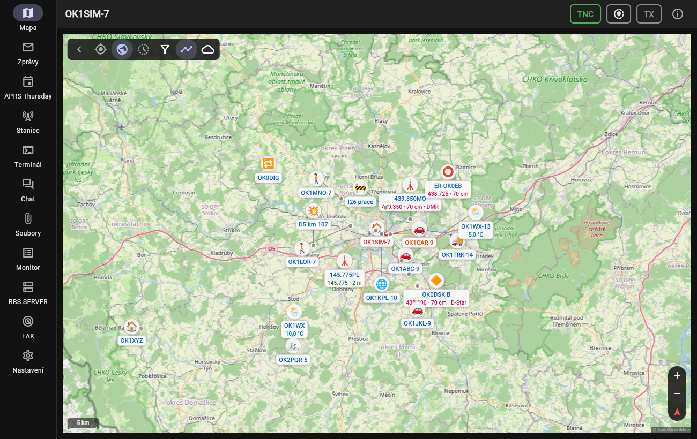</picture></a></p>

APRS stanice a packet radio terminál pro rádio s **KISS TNC** jako obyčejná aplikace pro počítač
i **telefon s Androidem** – bez Home Assistantu, bez webového serveru. Je to samostatný sourozenec
[integrace APRS & Packet pro Home Assistant](https://github.com/michalsiman/aprs-kiss-ha) a sdílí
s ní rádiové jádro.

Dělaná pro Quansheng UV-K1/UV-K5 V3 s [firmwarem F4HWN](https://github.com/armel/uv-k1-k5v3-firmware-custom)
a jeho [aplikací KISS TNC](https://github.com/armel/uv-k1-k5v3-firmware-custom/wiki/App-KISS-TNC), ale funguje
s jakýmkoliv KISS TNC (Direwolf, hardwarové TNC, USB sériový port rádia nebo KISS TCP most z integrace).
Ověřená funkčnost i s ručkami **VGC VR-N76** a **AnyTone UV890**.

**Stav: verze 1.1, aktivní vývoj.** Ostré verze (1.0, 1.1 …) jednou za čas, mezi nimi **beta verze** pro
testery – zaškrtněte v Nastavení *Nabízet i beta verze* (viz [CHANGELOG](CHANGELOG.md), anglicky).
Připravená pro **Linux**, **Windows** a **Android**; sestavení pro **macOS** a **iOS** existují, ale na
skutečném Macu, iPhonu ani iPadu je zatím nikdo nevyzkoušel – **hledáme testery** (viz [Platformy](#platformy)).

**Vyzkoušeno na pásmu** (děkuji!): Linux a Windows s **Quanshengem** na USB kabelu; Windows s **VGC VR-N76**
a **AnyTone 890** přes Bluetooth; **Direwolf** přes TCP/IP z jiného počítače; **tracker** na Androidu v autě
s Quanshengem na USB kabelu i samostatně přes internet (APRS-IS). **Budu moc rád za nové testery a zpětnou
vazbu** – jakékoli rádio, TNC i platforma: napište [issue](https://github.com/michalsiman/aprs-kiss-app/issues).

## Co umí

### APRS

- **Mapa** slyšených stanic (OpenStreetMap) s APRS symboly a popisky značek v rámečku, vaše poloha,
  zvýrazněné sledované značky. Tlačítka pro vycentrování na vás, *Tlumená mapa*, která mapu ztlumí,
  aby stanice vynikly, stanice z internetu zapnout/vypnout, jen *Posledních 2 h* a legenda
  symbolů – malé ikonky, které svítí, když jsou zapnuté. Tlačítka zoomu, kompas, který mapu vrátí severem
  nahoru, měřítko; dvěma prsty se mapa otočí jen výrazným natočením. Pravé tlačítko (na telefonu podržení
  prstu) na mapě: *Nastavit jako moji polohu*. Kreslí se jen stanice v okolí toho, co je na obrazovce,
  takže mapa zůstává svižná i na telefonu.
- **Offline mapa** přímo v aplikaci: hranice států, pobřeží a asi 1 000 větších měst (Natural Earth),
  v Evropě i dálnice a hlavní silnice (Natural Earth), asi 67 000 obcí nad 1 000 obyvatel a 30 nejvyšších
  hor každé země (GeoNames) – s přiblížením přibývají další. Přepíná se jedním tlačítkem; **když není internet, mapa se na ni
  přepne sama** a oznámí to, a jakmile se internet vrátí, vrátí se k OpenStreetMap.
- **Filtry mapy** (trychtýř): jen **meteostanice**, jen **jedoucí** stanice (pohnuly se za posledních
  10 minut; nově slyšená stanice zůstane, dokud není jasné, že stojí), jen **převaděče**, jen **dopravní
  problémy** (nehody, práce na silnici, povodně, mlha, sníh) – libovolně kombinovatelné, pamatují se.
- **Převaděče ukazují kmitočet** přímo ve štítku – pásmo barevně (2 m zeleně, 70 cm purpurově) a druh
  provozu, pokud je v komentáři (DMR, D-Star, C4FM, NXDN, TETRA). Stejně tak **meteostanice ukazují
  teplotu**.
- **Značky se nepřekrývají**: stanice na jednom místě nebo blízko sebe se rozestoupí, tenká šedá čára vede
  ze středu symbolu k tečce, kde stanice opravdu je. **Ocásky** (poslední půlhodina, i vaše vlastní z GPS),
  APRS **objekty** jako samostatná místa, nesmyslné skoky se ignorují. **Měření vzdálenosti** podržením
  prstu na dvou bodech.
- **Mapa jako navigace, když běží tracker**: jste uprostřed s přiblížením na ulice; posunete-li mapou,
  tlačítko **Zpět na mě** odpočítává 15 s a pak se mapa vrátí sama.
- **Upozornění před vámi, když běží tracker** (vypnutá, dokud je nezapnete): **dopravní hlášení**
  a **jiné jedoucí stanice** (jedou stejným směrem, proti vám, nebo křižují) v laloku před vámi – při
  rychlé jízdě dlouhém a úzkém, ve městě širokém, nikdy za vámi; bublina a zvuk.
- **Profily**: až tři SSID vaší značky, každé s vlastní ikonou (auto, ručka, domov); klepnutím na značku
  v horní liště se přepne – poloha, zprávy, terminál, vše jde pod ním.
- **APRS-IS**: jedním přepínačem se poloha (teď, pravidelně, tracker) i zprávy posílají i přes internet;
  s vypnutým vysíláním jde vše jen přes internet.
- **Tracker**: tlačítko polohy v horní liště pošle polohu jednou, nebo spustí tracker (▶) – poloha z GPS
  se pak posílá sama, v pevném intervalu nebo **chytře (SmartBeaconing)** jako APRS a LoRa APRS trackery:
  když stojíte zřídka, čím rychleji jedete tím častěji, hned v zatáčce; s kurzem a rychlostí. Rádiem jde,
  když je zapnuté TX (a přes internet, pokud je to zvolené).
- **Vlastní offline mapa** (Nastavení › Offline mapy): nahrajte si lepší mapu, třeba turistickou,
  odkudkoli – rastrové dlaždicové mapy **MBTiles, PMTiles, SQLiteDB** (OsmAnd, Locus), **ZIP** s dlaždicemi
  z/x/y nebo ZIP/7z, ve kterém jsou takové soubory (7z na počítači se 7-Zipem). I víc map naráz; tlačítkem
  mapy se volí *online*, *stažená* a *základní offline*. Vektorové mapy (Mapsforge, vektorové MBTiles) nejdou.
- **Zprávy** jako konverzace: opakované až do potvrzení, se stavem doručení, příchozí se potvrzují
  automaticky; nová zpráva na libovolnou značku; upozornění, když nějaká přijde. Delší text odejde jako
  více zpráv číslovaných 1/2, 2/2 …; v konverzaci je vidět, jak daleko stanice je (i jak daleko byla, když
  zpráva přišla) s tlačítkem na mapu; konverzace jde smazat.
- **Poloha ve zprávách a v chatu**: pošlete svoji, nebo libovolné místo vybrané na mapě – jako souřadnice
  nebo jako lokátor (nabídka mapy ukazuje lokátor každého místa); poloha napsaná ve zprávě nebo v chatu
  (desetinné stupně, stupně a minuty, APRS zápis, lokátor) se otevře na mapě se špendlíkem.
- **Ohlášení aktivace** (Zprávy › Spot): SOTA, POTA, WWFF, SIOTA, GMA, hrady WCA, IOTA a majáky –
  self-spot jde rádiem jako APRS zpráva na APRS2SOTA, Camillu (GMA) nebo APSPOT, zkontrolovaný a zkrácený,
  aby se vešel, s odpovědí brány v její konverzaci.
- **Služby na APRS** (Zprávy › Služby): FIND (kde byla stanice naposledy slyšet), REPEAT (nejbližší
  převaděče), WXNOW (počasí z nejbližší meteostanice), UTC, přelety satelitů a východ slunce (9M2PJU-4),
  e-mail (MAILMY) – klepnutím se příkaz vloží do zprávy, odpověď přijde zprávou.
- **#APRSThursday**: vlastní sekce pro čtvrteční síť HOTG přes ANSRVR – zapojení jedním tlačítkem,
  zprávy skupiny zvlášť mimo běžné zprávy, kdy začíná další akce, odhlášení ze skupiny.
- **Stanice** slyšené rádiem nebo viděné na APRS-IS: vzdálenost, směr, komentář, počasí, cesta;
  filtr a legenda. Objeví se i stanice, které iGate pošle z internetu do rádia (pakety třetí strany).
- **Maják polohy** každých N minut a tlačítko *Poslat polohu teď* v horní liště; status a unproto.
  Ikona (APRS symbol), komentář, SSID a cesta v Nastavení.
- **Digipeater**: fill-in (WIDE1-1, pro domácí stanici) nebo plný (WIDEn-N s omezením počtu hopů),
  rámce adresované vaší značce nebo aliasům (např. RELAY), stejný paket jen jednou za 30 sekund.
- **APRS-IS** (internet) s volitelným **iGate** pro příjem i vysílání; zprávy, které vám iGate pošle
  rádiem, se přijmou a potvrdí.
- **Poloha z GPS**: z GPS telefonu (na telefonu bez ručně zadané polohy výchozí; Nastavení ukazuje,
  kde podle ní jste), nebo z **USB GPS modulu** (NMEA, u-blox/VK-172 a podobné, rychlost se zjistí sama): s fixem používá jeho polohu
  mapa, maják (i s výškou) a TAK; stav GPS je v horní liště.

### Packet rádio

- **Terminál**: AX.25 spojení s BBS a nody, klidně přes digipeatery; seznam **uložených BBS** k výběru;
  pokusy o připojení s časy a tlačítko *Zastavit připojování*; volitelně příchozí spojení.
- **Terminál přes VARA FM**: stejný terminál přes VARA FM místo AX.25 – *Připojení: VARA FM*.
  VARA běží zvlášť (Windows, nebo Wine na Linuxu) s rádiem na zvukové kartě, např. kabelem AIOC;
  aplikace s ní mluví přes její TCP rozhraní (porty 8300/8301) a ukazuje průběh spojení, PTT
  a buffer pro vysílání.
- **Soubory**: posílání a příjem souborů přes packet radio – YAPP (standard BPQ, WinPacku, Paxonu) přes
  spojení AX.25 s potvrzováním; před odesláním odhad času, během přenosu průběh, rychlost a zbývající čas;
  každý příchozí soubor se nejdřív nabídne; přerušený přenos naváže.
- **Chat**: prostý text na CQ, QST, ALL nebo vám, slyší ho všichni na kmitočtu; automatické rámce jako
  DX hlášení digipeaterů do chatu nepatří. Jak ho použít v jiném softwaru popisuje
  **[specifikace chatu](docs/CHAT.cs.md)**.
- **Monitor**: všechny přijaté i odeslané rámce jako na TNC, s pozastavením a vymazáním; umí skrýt
  řádky z APRS-IS a TAK rámce ukazuje dekódované.
- **BBS SERVER**: vlastní packetová BBS na vaší značce s vlastním SSID – klasické příkazy W0RLI / MBL / FBB,
  osobní zprávy a bulletiny, limity pro počet klientů, nečinnost, čas vysílání a počet uložených zpráv;
  nastavení a texty v obyčejných souborech (bbs.toml, welcome.txt, …), každá zpráva v jednom textovém
  souboru. Dokud běží, je všechno ostatní v aplikaci vypnuté (rádio je na kmitočtu BBS, nikdy ne na
  144.800); zapnutí vyžaduje napsat potvrzovací větu. Viz **[návod k BBS SERVER](docs/BBS.cs.md)**.
- **TAK**: aplikace jako TAK stanice přes rádio – polohy a GeoChat kompatibilní s ATAK (TAK Protocol v1
  v AX.25 UI rámcích), vlastní mapa se stanicemi barevně podle týmu, seznam stanic, zprávy všem nebo
  jedné stanici; tým, role a značka v Nastavení; kdo se objevil na mapě a kdo se posunul jak daleko,
  ukazuje GeoChat. Na telefonu jsou mapa a GeoChat dvě obrazovky a na ikonce GeoChatu je počet
  nepřečtených zpráv. Rámce se vejdou i do LoRa KISS modemů (MeshCore). Stejně jako BBS SERVER vypne
  všechno ostatní.
  Viz **[specifikace TAK](docs/TAK.cs.md)**.

### Aplikace

- **Horní lišta jako přístrojová deska**, na počítači i na telefonu: kontrolky **TNC**, **IS** a **GPS**
  svítí zeleně, když fungují, tlačítko polohy / trackeru, **TX** s červeným rámečkem při zapnutém vysílání
  a celé červené, když rámec odchází do éteru (IS na vteřinu zčervená, když něco jde do APRS-IS). Na počítači
  jsou kontrolky větší a po najetí myší řeknou svůj stav; na telefonu jsou TNC, IS a GPS v jednom malém
  bloku, aby se vešla celá značka.
- **KISS přes TCP** (Direwolf, síťový most) nebo **sériový/USB port** (seznam portů, na Linuxu se
  stálými názvy `/dev/serial/by-id`); TX delay pro TNC; po výpadku se připojí sama.
- **16 jazyků**: brazilská portugalština, čeština, dánština, angličtina, francouzština, chorvatština,
  italština, němčina, norština (bokmål), polština, slovenština, slovinština, srbština (cyrilice),
  španělština, švédština a ukrajinština; řídí se jazykem systému, nebo si ho vyberete v Nastavení.
- **Světlý a tmavý** vzhled podle systému, nebo podle volby v Nastavení.
- **Zvuky**: pípnutí při vysílání, zvuk při nové APRS zprávě, zprávě v chatu a v TAK GeoChatu – každý
  jde v Nastavení zapnout nebo vypnout.
- **Nezhasínat obrazovku**: nikdy, když běží TAK, nebo vždy.
- **Nastavení ve sbalených blocích**; značka je povinná (dokud není uložená, je orámovaná červeně).
  Potvrzovací věty (TAK, BBS SERVER, licence pro APRS-IS) se opisují jen jednou, ne pokaždé.
- **Při prvním spuštění** se zeptá na jazyk (nabídne jazyk zařízení) a ukáže upozornění, které je
  potřeba přijmout: vysílat smí jen držitel radioamatérské licence.
- Dá vědět, když vyjde nová verze: nejvýš jednou denně se zeptá GitHubu na poslední vydání,
  nic o vás neposílá; v Nastavení se dá vypnout. Na Androidu *Stáhnout* rovnou stáhne nové .apk.

### Na telefonu (Android)

- Obrazovky jsou v nabídce, která se vysune ze strany (☰); horní lišta je jako přístrojová deska:
  kontrolky **TNC**, **IS** a **GPS** svítí zeleně, když fungují, **TX** má červený rámeček, když je
  vysílání zapnuté, a je celá červená, když rámec právě odchází do éteru – klepnutím na TX se vysílání
  zapne nebo vypne, klepnutí na TNC nebo GPS ukáže jejich stav.
- **TNC na USB portu telefonu** (OTG kabel): Quansheng s KISS firmwarem F4HWN a další CDC-ACM TNC,
  kabely CP210x a FTDI; **přes Bluetooth** (spárované TNC nebo rádio se sériovým profilem SPP, např.
  Mobilinkd TNC3 nebo ručka s Bluetooth KISS TNC); **přes Bluetooth LE** (KISS over BLE: LoRa APRS tracker,
  Mobilinkd TNC4, PicoAPRS …, najde je hledání v Nastavení); nebo po síti.
- **GPS telefonu** jako vaše poloha.
- **Běh na pozadí** (Nastavení › Pozadí a obrazovka): příjem, majáky, zprávy i TAK běží dál, i když
  aplikace není na obrazovce nebo je telefon zamčený; ukazuje to notifikace.

> **Vysílání je ve výchozím stavu vypnuté.** *Vysílání* v horní liště zapněte jen tehdy, když máte
> radioamatérské oprávnění. APRS-IS jde zapnout až po napsání věty o licenci.

## Snímky obrazovky

Pořízené se simulovaným TNC (`tests/fake_tnc.py --scene --tak`, `tools/screenshots.py`); kliknutím se
zvětší. Řídí se motivem GitHubu, stejně jako aplikace: používá světlý nebo tmavý režim systému.

<table>
<tr>
<td colspan="2"><a href="assets/cs/map.png"><picture><source media="(prefers-color-scheme: light)" srcset="assets/cs/map-light.png"></picture></a><br><sub>Mapa: symboly, převaděče s kmitočtem, nehoda, ocásky</sub></td>
</tr>
<tr>
<td colspan="2"><a href="assets/cs/phone-map.png"><picture><source media="(prefers-color-scheme: light)" srcset="assets/cs/phone-map-light.png">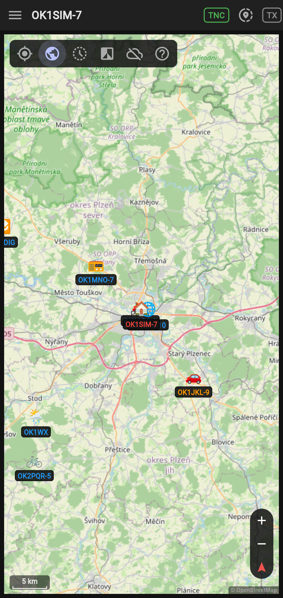</picture></a> <a href="assets/cs/phone-filter.png"><picture><source media="(prefers-color-scheme: light)" srcset="assets/cs/phone-filter-light.png">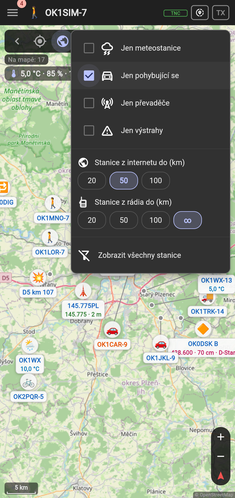</picture></a> <a href="assets/cs/phone-profiles.png"><picture><source media="(prefers-color-scheme: light)" srcset="assets/cs/phone-profiles-light.png">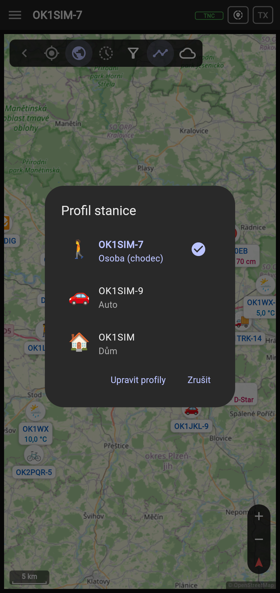</picture></a> <a href="assets/cs/phone-menu.png"><picture><source media="(prefers-color-scheme: light)" srcset="assets/cs/phone-menu-light.png">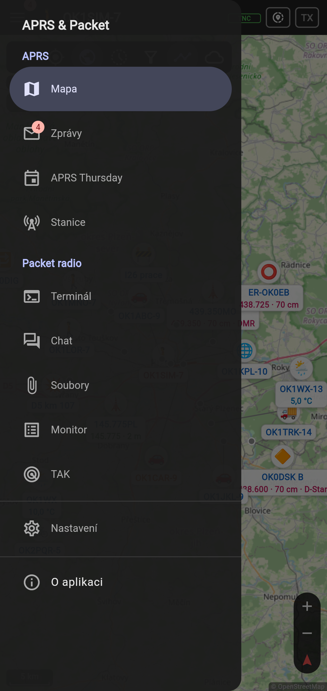</picture></a> <a href="assets/cs/phone-settings.png"><picture><source media="(prefers-color-scheme: light)" srcset="assets/cs/phone-settings-light.png">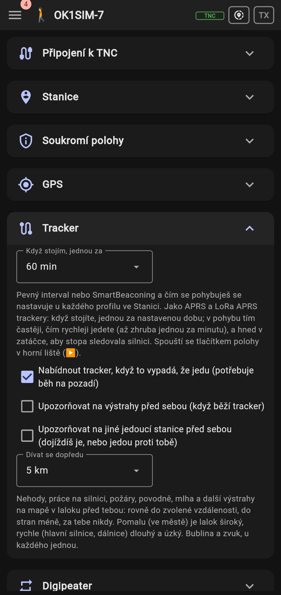</picture></a> <a href="assets/cs/phone-tak.png"><picture><source media="(prefers-color-scheme: light)" srcset="assets/cs/phone-tak-light.png">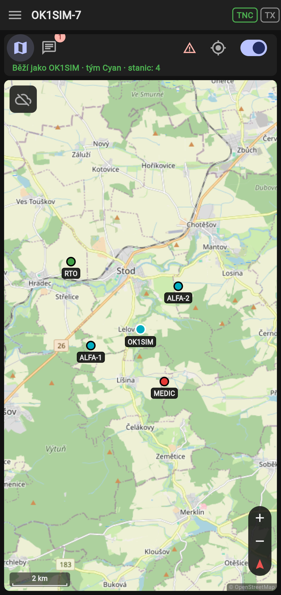</picture></a> <a href="assets/cs/phone-tak-chat.png"><picture><source media="(prefers-color-scheme: light)" srcset="assets/cs/phone-tak-chat-light.png">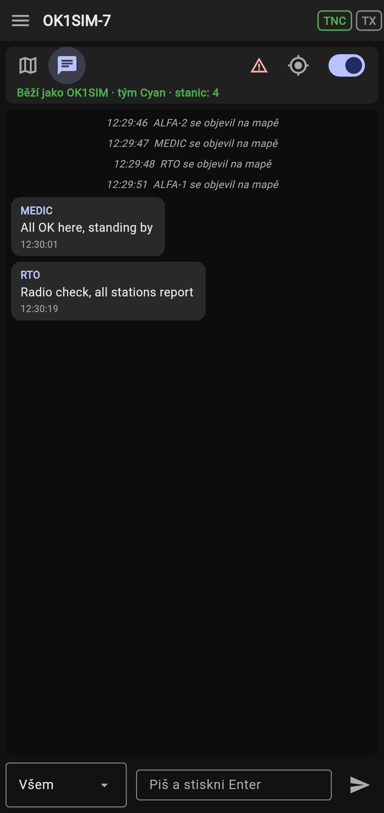</picture></a><br><sub>Na telefonu: mapa, filtry, profily, nabídka, nastavení, mapa TAK, TAK GeoChat</sub></td>
</tr>
<tr>
<td width="50%"><a href="assets/cs/map-filter.png"><picture><source media="(prefers-color-scheme: light)" srcset="assets/cs/map-filter-light.png">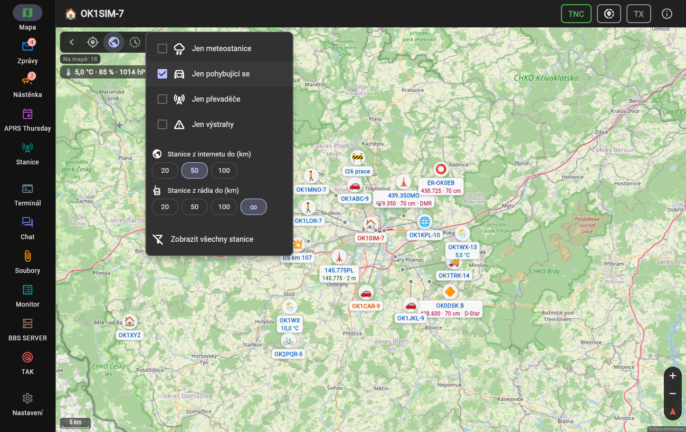</picture></a><br><sub>Filtry mapy</sub></td>
<td width="50%"><a href="assets/cs/map-repeaters.png"><picture><source media="(prefers-color-scheme: light)" srcset="assets/cs/map-repeaters-light.png">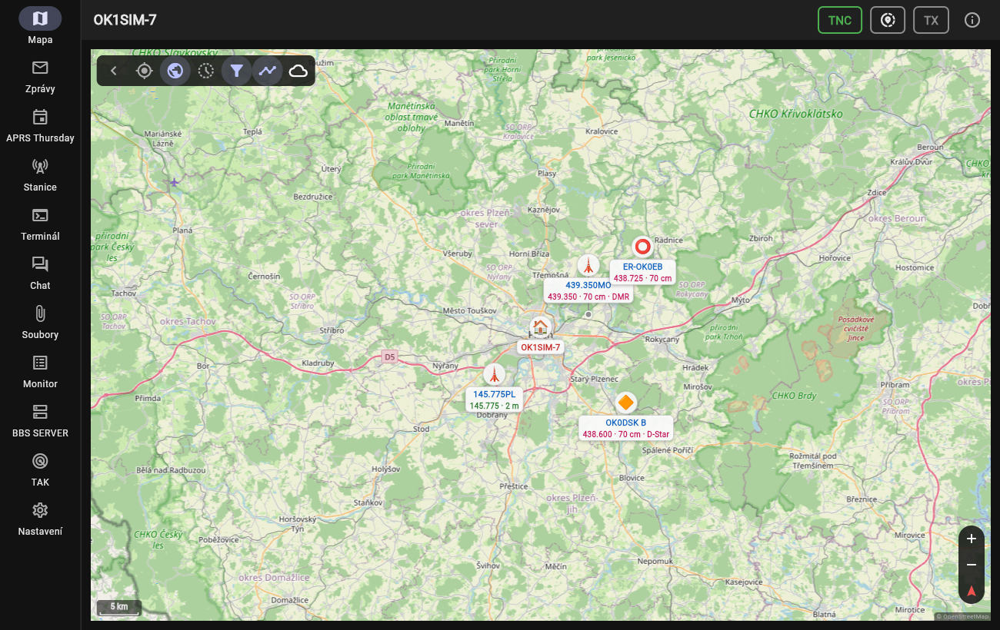</picture></a><br><sub>Jen převaděče s kmitočtem, pásmem a druhem provozu</sub></td>
</tr>
<tr>
<td width="50%"><a href="assets/cs/map-offline.png"><picture><source media="(prefers-color-scheme: light)" srcset="assets/cs/map-offline-light.png">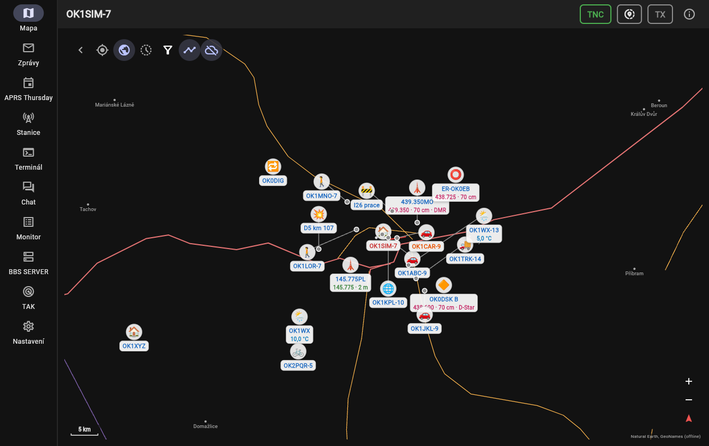</picture></a><br><sub>Základní offline mapa (bez internetu)</sub></td>
<td width="50%"><a href="assets/cs/messages.png"><picture><source media="(prefers-color-scheme: light)" srcset="assets/cs/messages-light.png">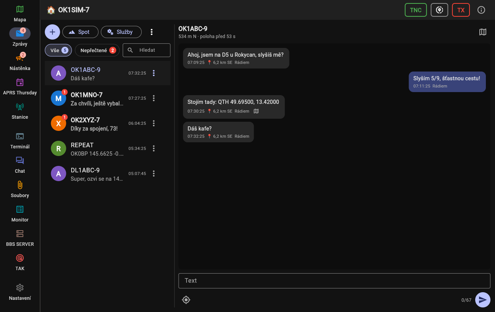</picture></a><br><sub>Zprávy jako konverzace</sub></td>
</tr>
<tr>
<td width="50%"><a href="assets/cs/thursday.png"><picture><source media="(prefers-color-scheme: light)" srcset="assets/cs/thursday-light.png"></picture></a><br><sub>#APRSThursday</sub></td>
<td width="50%"><a href="assets/cs/stations.png"><picture><source media="(prefers-color-scheme: light)" srcset="assets/cs/stations-light.png">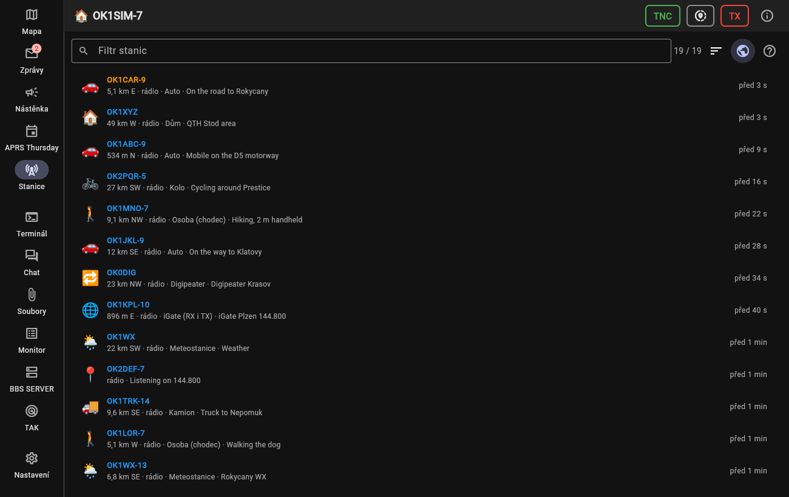</picture></a><br><sub>Stanice se vzdáleností a směrem</sub></td>
</tr>
<tr>
<td width="50%"><a href="assets/cs/terminal.png"><picture><source media="(prefers-color-scheme: light)" srcset="assets/cs/terminal-light.png"></picture></a><br><sub>Terminál: připojeno k BBS přes AX.25</sub></td>
<td width="50%"><a href="assets/cs/chat.png"><picture><source media="(prefers-color-scheme: light)" srcset="assets/cs/chat-light.png">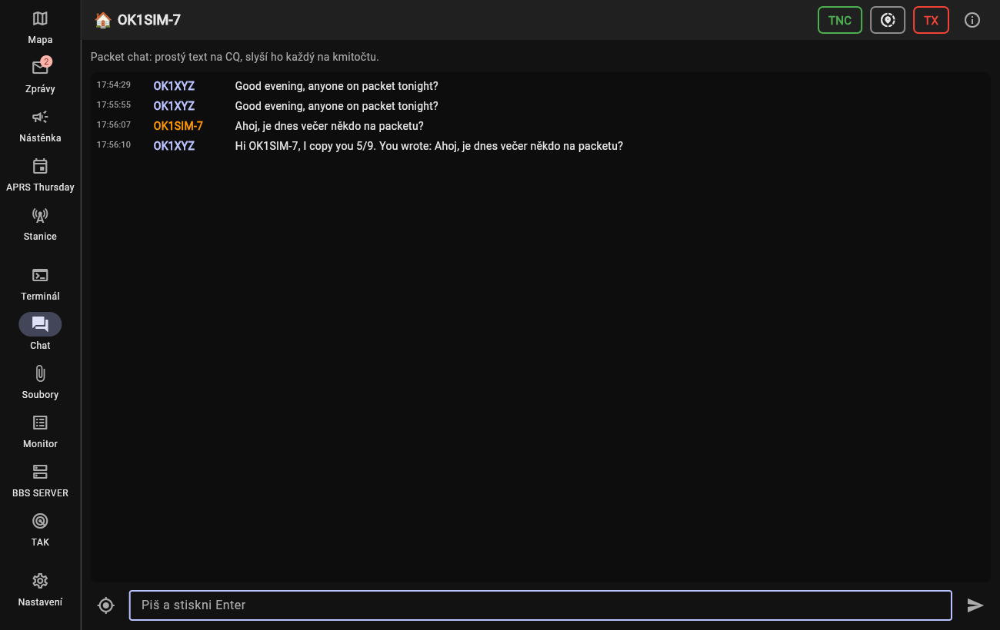</picture></a><br><sub>Packet chat</sub></td>
</tr>
<tr>
<td width="50%"><a href="assets/cs/monitor.png"><picture><source media="(prefers-color-scheme: light)" srcset="assets/cs/monitor-light.png"></picture></a><br><sub>Monitor rámců</sub></td>
<td width="50%"><a href="assets/cs/settings-tracker.png"><picture><source media="(prefers-color-scheme: light)" srcset="assets/cs/settings-tracker-light.png">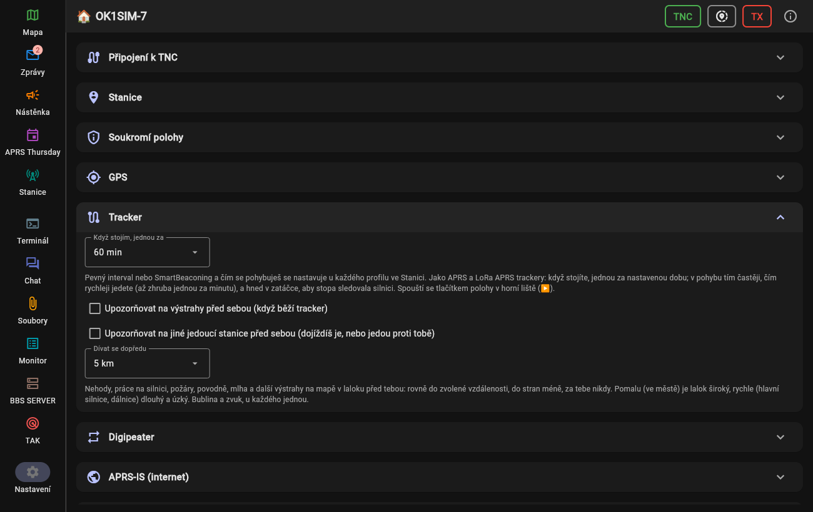</picture></a><br><sub>Tracker a upozornění před tebou</sub></td>
</tr>
<tr>
<td width="50%"><a href="assets/cs/files.png"><picture><source media="(prefers-color-scheme: light)" srcset="assets/cs/files-light.png">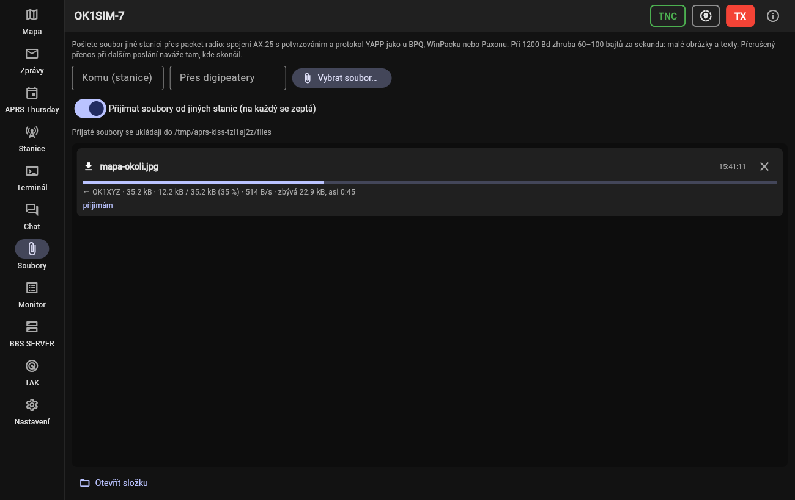</picture></a><br><sub>Soubory: příjem obrázku přes packet radio, průběh a zbývající čas</sub></td>
<td width="50%"><a href="assets/cs/files-offer.png"><picture><source media="(prefers-color-scheme: light)" srcset="assets/cs/files-offer-light.png">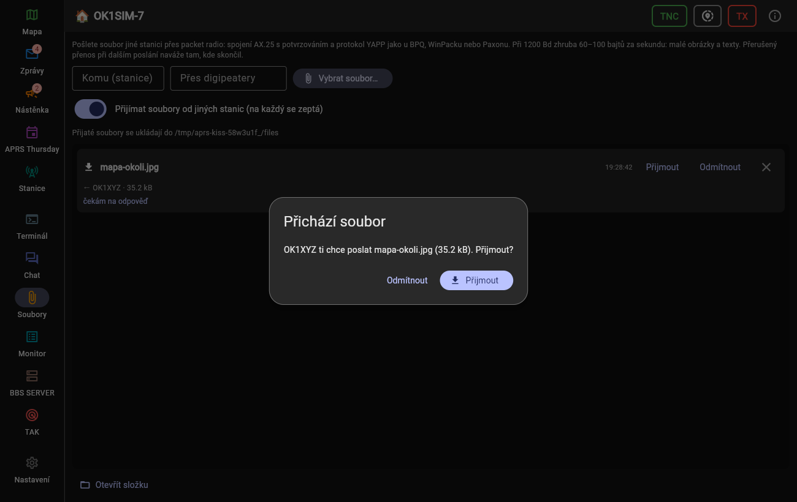</picture></a><br><sub>Soubor od jiné stanice se nejdřív nabídne</sub></td>
</tr>
<tr>
<td colspan="2"><a href="assets/cs/tak.png"><picture><source media="(prefers-color-scheme: light)" srcset="assets/cs/tak-light.png">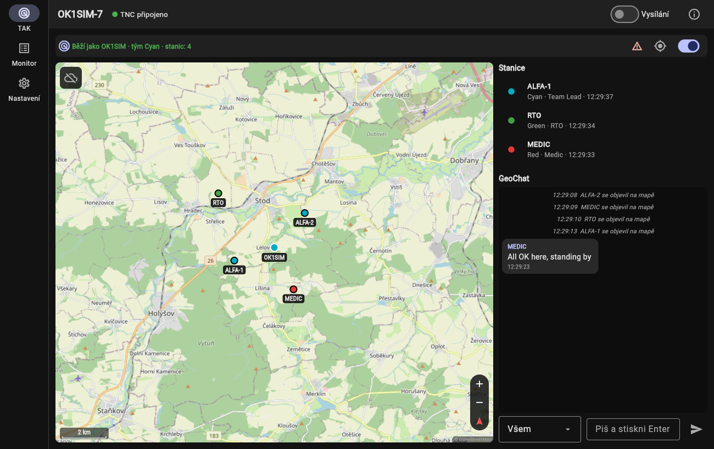</picture></a><br><sub>TAK: stanice podle týmů a GeoChat</sub></td>
</tr>
<tr>
<td width="50%"><a href="assets/cs/bbs.png"><picture><source media="(prefers-color-scheme: light)" srcset="assets/cs/bbs-light.png"></picture></a><br><sub>BBS SERVER</sub></td>
<td width="50%"><a href="assets/cs/bbs-confirm.png"><picture><source media="(prefers-color-scheme: light)" srcset="assets/cs/bbs-confirm-light.png">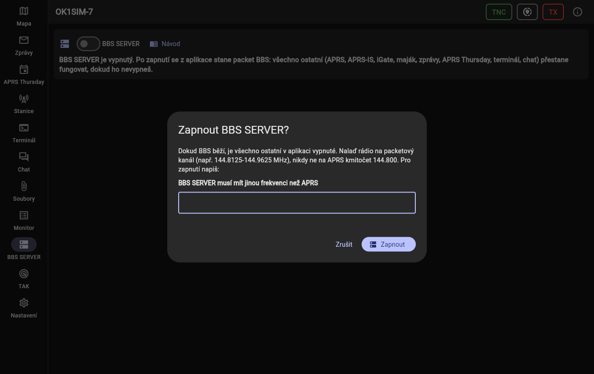</picture></a><br><sub>BBS SERVER se zapíná opsáním věty</sub></td>
</tr>
<tr>
<td width="50%"><a href="assets/cs/settings.png"><picture><source media="(prefers-color-scheme: light)" srcset="assets/cs/settings-light.png"></picture></a><br><sub>Nastavení: stanice a profily</sub></td>
<td width="50%"><a href="assets/cs/settings-more.png"><picture><source media="(prefers-color-scheme: light)" srcset="assets/cs/settings-more-light.png">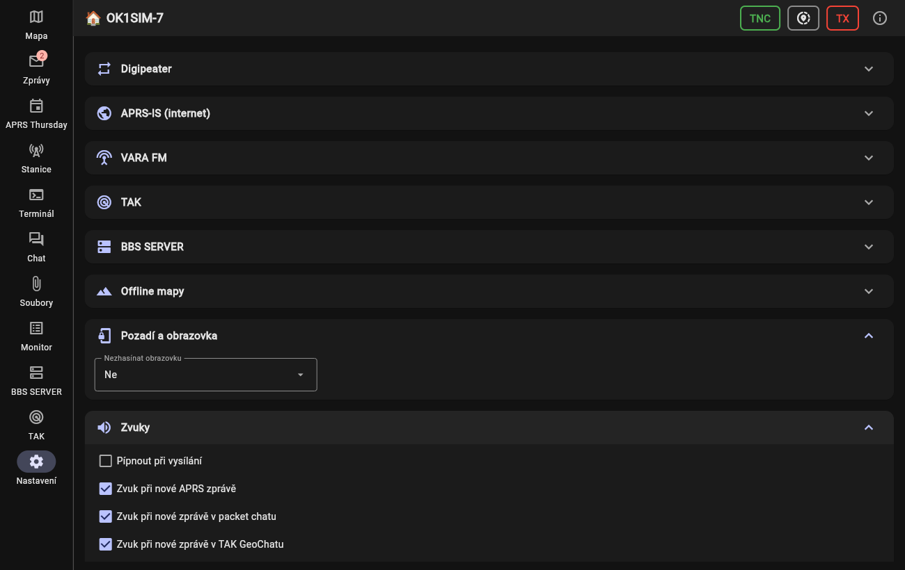</picture></a><br><sub>Nastavení: pozadí a obrazovka, zvuky</sub></td>
</tr>
</table>

## Instalace (Windows)

Stáhněte **`aprs-kiss-…-windows-x64-setup.exe`** z
[posledního vydání](https://github.com/michalsiman/aprs-kiss-app/releases/latest) a spusťte ho, nebo vezměte
**`…-windows-x64.zip`** a rozbalte ho kamkoliv. Rádio na USB se v Nastavení ukáže jako COM port.

## Instalace (macOS)

Stáhněte **`aprs-kiss-…-macos.dmg`** z
[posledního vydání](https://github.com/michalsiman/aprs-kiss-app/releases/latest), otevřete ho a přetáhněte
*APRS & Packet* do Aplikací. Aplikace není podepsaná u Applu (bez placeného vývojářského účtu), takže
poprvé na ni **klikněte pravým › Otevřít › Otevřít**, nebo ji povolte v *Nastavení systému › Soukromí
a zabezpečení › Přesto otevřít*. Rádio na USB se v Nastavení ukáže jako `/dev/cu.usbserial…` /
`/dev/cu.usbmodem…`. Verze pro macOS se sestavuje na GitHubu bez Macu, na kterém by se dala vyzkoušet – **hledáme testery**:
napište do [issues](https://github.com/michalsiman/aprs-kiss-app/issues), jak to dopadlo.

## Instalace (Android)

Stáhněte v telefonu **`aprs-kiss-…-android.apk`** z
[posledního vydání](https://github.com/michalsiman/aprs-kiss-app/releases/latest) a otevřete ho; Android
se jednou zeptá, jestli smí prohlížeč nebo správce souborů instalovat aplikace. V telefonu se aplikace
připojuje k TNC **přes USB port telefonu** (Nastavení › Připojení: TNC na USB, přes OTG kabel nebo
redukci; Quansheng s KISS firmwarem F4HWN a další CDC-ACM TNC, kabely CP210x a FTDI; Android se jednou
zeptá, jestli to aplikaci povolí) nebo **po síti (KISS přes TCP)**: Direwolf na počítači, rádio sdílené
přes [`kiss_tcp_bridge.py`](https://github.com/michalsiman/aprs-kiss-ha/tree/main/bridge) nebo Wi-Fi TNC.
Obrazovky jsou upravené pro telefon a přepínají se v nabídce, která se vysune ze strany (☰). Polohu může aplikace
brát z **GPS telefonu** (Nastavení › GPS). BBS SERVER a USB GPS moduly jsou jen pro počítače.
Soubor .apk je podepsaný vlastním klíčem projektu, takže nová verze se nainstaluje přes předchozí (od 0.1.30;
starší je potřeba jednou odinstalovat); aplikace dá vědět, když nová verze vyjde, a stáhne ji.
Připravuje se vydání v Google Play.

## Instalace (iPhone, iPad)

Apple pouští aplikace do iPhonu jen přes App Store nebo podepsané vývojářským účtem, který tento
projekt nemá. Ve vydání je **nepodepsaný `aprs-kiss-…-ios-unsigned.ipa`**, který si do zařízení dáte
nástrojem pro sideloading jako [AltStore](https://altstore.io/) nebo [Sideloadly](https://sideloadly.io/);
ten ho podepíše vaším vlastním Apple ID (s bezplatným Apple ID je potřeba ho každých 7 dní obnovit).
K TNC se připojuje po síti nebo přes **Bluetooth LE** (KISS over BLE – klasický sériový Bluetooth iOS
aplikacím nedovolí).
**Na skutečném iPhonu ani iPadu zatím vyzkoušený není – hledáme testery:** pokud to můžete zkusit,
napište prosím, jak to dopadlo, do [issues](https://github.com/michalsiman/aprs-kiss-app/issues).

## Instalace (Linux)

**S automatickými aktualizacemi (Flatpak):** otevřete
**[michalsiman.github.io/aprs-kiss-app](https://michalsiman.github.io/aprs-kiss-app/)** a klikněte na
*Instalovat*, nebo spusťte

```bash
flatpak install https://michalsiman.github.io/aprs-kiss-app/aprs-kiss.flatpakref
```

(Bez `--user`: Správce aktualizací a Správce softwaru v Linux Mintu vidí jen celosystémovou
instalaci, takže tam se aktualizace objeví.) Funguje na každé distribuci s Flatpakem (Linux Mint,
Fedora, Ubuntu s Flatpakem, …). Nové verze pak chodí spolu s ostatními aktualizacemi z vlastního
podepsaného Flatpak repozitáře (otisk klíče `0E31 685C C5D6 4B8C 7837  B62F 66ED ABD8 50DC 14BD`).

**Nebo si stáhněte balíček** z [posledního vydání](https://github.com/michalsiman/aprs-kiss-app/releases/latest)
a otevřete ho dvojklikem:

- **`aprs-kiss-…-x86_64.flatpak`**: stejný Flatpak jako jeden soubor; aktualizuje se také
  z repozitáře výše (vydání od 0.1.5).
- **`aprs-kiss_…_amd64.deb`**: Debian, Ubuntu, Linux Mint (22.04 / Debian 12 a novější).
- **`aprs-kiss-…-linux-x86_64.tar.gz`**: rozbalte kamkoliv a spusťte `./aprs-kiss`.

Žádný z nich nepotřebuje Python. Pro TNC na USB sériovém portu musí být váš uživatel ve skupině
`dialout`: `sudo usermod -aG dialout $USER`, pak se odhlaste a znovu přihlaste.

### S Pythonem

Python 3.10 nebo novější.

```bash
pipx install "aprs-kiss[desktop] @ git+https://github.com/michalsiman/aprs-kiss-app"
aprs-kiss
```

Nebo ze zdrojových kódů:

```bash
git clone https://github.com/michalsiman/aprs-kiss-app && cd aprs-kiss-app
python3 -m venv .venv && .venv/bin/pip install -e ".[dev]"
.venv/bin/flet run src/main.py      # nebo: .venv/bin/aprs-kiss
```

Při prvním spuštění se otevře **Nastavení**: zadejte svou značku, polohu a jak se dostat k TNC:

- **KISS přes TCP** – Direwolf (port 8001), nebo rádio sdílené po síti pomocí
  [`kiss_tcp_bridge.py`](https://github.com/michalsiman/aprs-kiss-ha/tree/main/bridge)
- **Sériový port** – rádio připojené k tomuto počítači; vyberte ho ze seznamu
  (názvy `/dev/serial/by-id/...` zůstanou stejné i po přepojení). Váš uživatel musí být ve skupině
  `dialout`: `sudo usermod -aG dialout $USER`, pak se odhlaste a znovu přihlaste.

Nastavení a historie zpráv jsou v `~/.local/share/aprs-kiss/` (změníte proměnnou `APRS_KISS_DATA`).

### Vyzkoušení bez rádia

```bash
.venv/bin/python tests/fake_tnc.py --port 8001 --mycall OK1SIM-7
```

Simulované TNC: každých pár sekund přijdou stanice, meteo hlášení a zprávy, potvrzuje vaše zprávy,
odpovídá v chatu a provozuje malou BBS (`OK0BBS`: H, L, B). Aplikaci nasměrujte na
`127.0.0.1:8001`. S `--tak` posílá i TAK stanice a GeoChat pro režim TAK.

```bash
.venv/bin/python tests/fake_vara.py --port 8300
```

Simulovaná VARA FM pro terminál: v Nastavení › VARA FM zadejte `127.0.0.1`, port 8300, a připojte se
přes *Připojení: VARA FM* na libovolnou značku (odpoví malá BBS: L, B; `NOANSWER` neodpoví nikdy).

### Balíčky

Workflow *Release packages* jednou spustí `flet build linux` a z výsledku udělá archiv, `.deb`
(`packaging/deb/build-deb.sh`) a Flatpak (`packaging/flatpak/`), které připojí ke každému vydání
`v*`. Položka do menu, AppStream metainfo a ikony jsou v `packaging/linux/`.

## Jak je postavená

```
src/
  aprs_kiss_core/   rádio, bez uživatelského rozhraní: KISS, AX.25 (UI i spojení), APRS,
                    APRS-IS/iGate, stanice (potvrzení, opakování, limity), BBS server (bbs/),
                    TAK (tak.py), USB GPS (gps.py), VARA FM (vara.py), APRS Thursday (thursday.py),
                    spoty (spotting.py), služby na APRS (services.py), způsoby připojení TNC
                    (android_usb.py, android_bt.py, ble.py) a Engine, který to spojuje a hlásí
                    události posluchačům
  aprs_kiss_app/    uživatelské rozhraní ve Fletu: jedna obrazovka = jeden view; data offline mapy (offline/)
  main.py           vstupní bod pro `flet run` / `flet build`
packages/
  flet-ble-kiss/    vlastní rozšíření Fletu: KISS přes Bluetooth LE v Dartu (universal_ble)
tests/              testy jednotek, testy enginu proti fake_tnc.py a fake_vara.py
```

- **Flet** (Python, vykresluje Flutter): jeden kód pro počítač i mobil, nativní okno,
  žádný webový server.
- **Způsoby připojení jsou rozšiřitelné** (`aprs_kiss_core.connection.register_transport`): TCP
  a sériový port jsou vestavěné; USB na Androidu, klasický Bluetooth (SPP) a Bluetooth LE jsou vlastní
  způsoby připojení bez zásahu do kódu KISS/AX.25. Bluetooth LE jde přes vlastní rozšíření Fletu
  (`packages/flet-ble-kiss`), které `flet build` přidá do sestavení pro každou platformu; při spuštění
  ze zdrojáků bez něj se Bluetooth LE prostě nenabízí.
- Moduly jádra jsou stejné jako v integraci pro Home Assistant (tam `hub.py`, tady `engine.py`).
  V plánu je vydat jádro jako jeden balíček, který budou používat obě.

Soukromí: aplikace nic nesbírá; viz [zásady ochrany osobních údajů](https://michalsiman.github.io/aprs-kiss-app/privacy.html).

## Platformy

Linux, Windows a Android se používají každý den; macOS a iOS se sestavují, ale nejsou vyzkoušené (hledáme testery).

| | Linux | Windows | macOS (nevyzkoušeno) | Android | iOS (nevyzkoušeno) |
|---|---|---|---|---|---|
| KISS přes TCP | ✅ | ✅ | ✅ | ✅ | ✅ (sideloading) |
| USB sériový port | ✅ | ✅ (COM porty) | ✅ | ✅ (OTG: CDC-ACM, CP210x, FTDI) | ❌ (iOS) |
| Bluetooth TNC (SPP) | ✅ (jako sériový port: rfcomm) | ✅ (jako COM port) | – | ✅ (spárované, v Nastavení) | ❌ (jen BLE) |
| Bluetooth LE TNC (KISS over BLE) | ✅ | ✅ | ✅ | ✅ | ✅ |
| USB GPS modul | ✅ | ✅ (COM porty) | ✅ | – | ❌ |
| GPS telefonu | – | – | – | ✅ | ✅ |
| VARA FM | ✅ (VARA ve Wine) | ✅ | VARA na jiném počítači | VARA na jiném počítači | VARA na jiném počítači |
| BBS SERVER | ✅ | ✅ | ✅ | – (jen počítače) | – (jen počítače) |
| Běh na pozadí | ✅ | ✅ | ✅ | ✅ (v Nastavení, s notifikací) | omezeno iOS |
| Nezhasínání obrazovky, zvuky | ✅ | ✅ | ✅ | ✅ | ✅ |

## Testy

```bash
.venv/bin/python -m unittest discover -s tests -t .
```

## Autoři a licence

- Napsal [Michal Šiman](https://github.com/michalsiman) ([OK1SIM](https://ok1sim.cz/)) společně
  s [Claude Code](https://claude.com/claude-code).
- Uživatelské rozhraní [Flet](https://flet.dev) (Flutter), mapy [flutter_map](https://github.com/fleaflet/flutter_map)
  přes flet-map, mapová data © přispěvatelé OpenStreetMap.
- Offline mapa z [Natural Earth](https://www.naturalearthdata.com/) (volné dílo) a
  [GeoNames](https://www.geonames.org/) (CC BY 4.0).
- Zpracování APRS [aprslib](https://github.com/rossengeorgiev/aprs-python).
- [Firmware F4HWN](https://github.com/armel/uv-k1-k5v3-firmware-custom) pro Quansheng UV-K1/K5 V3 od **Armela F4HWN**,
  jeho [aplikace KISS TNC](https://github.com/armel/uv-k1-k5v3-firmware-custom/wiki/App-KISS-TNC) od **F4WAT**.

Licence MIT, viz [LICENSE](LICENSE).
