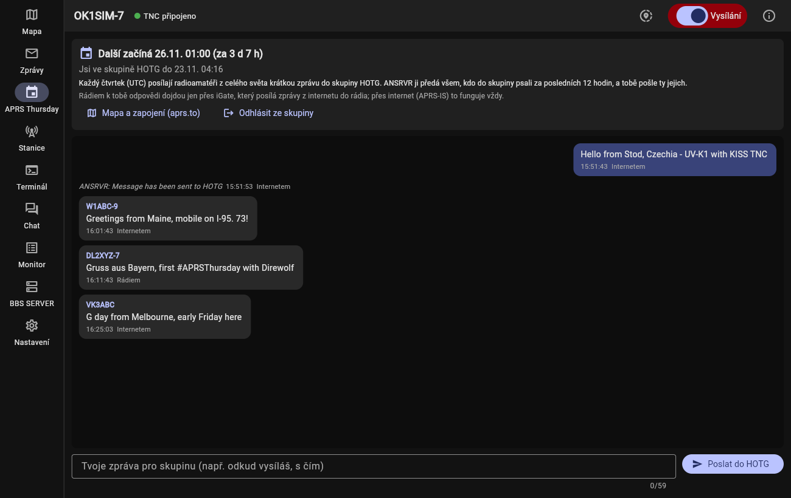
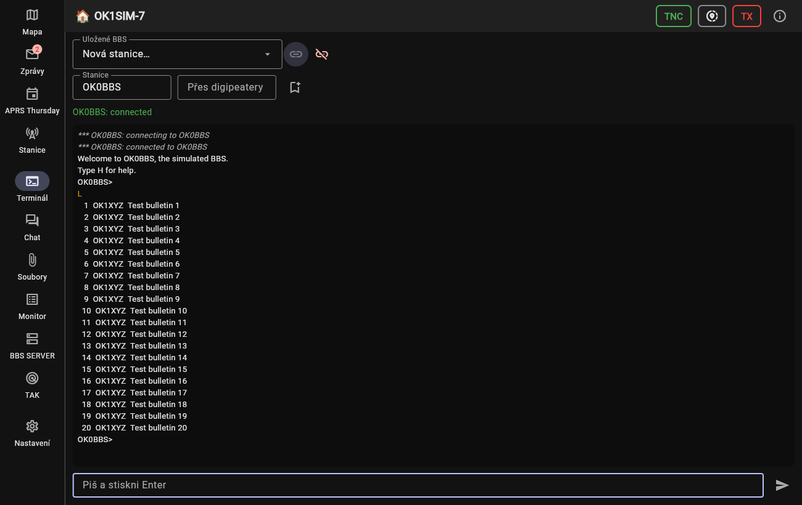
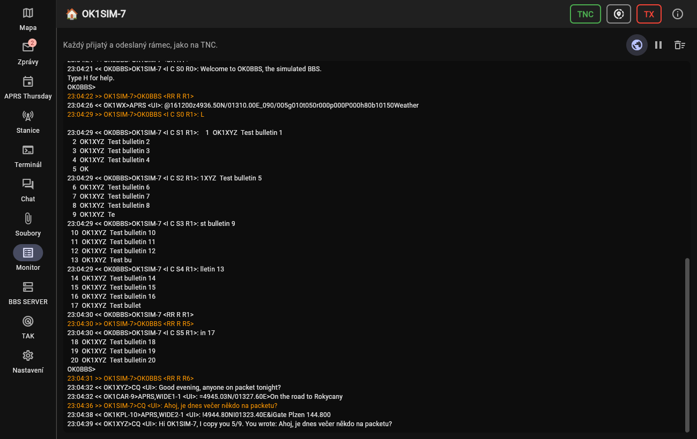
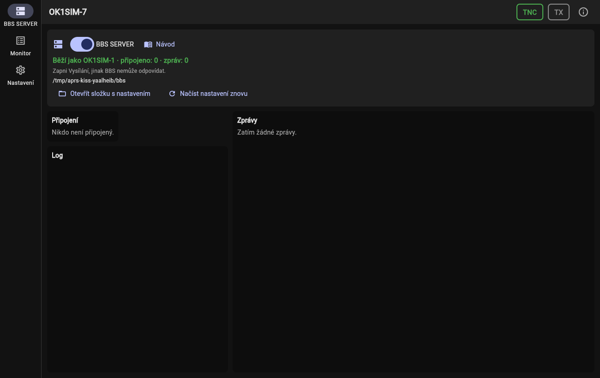
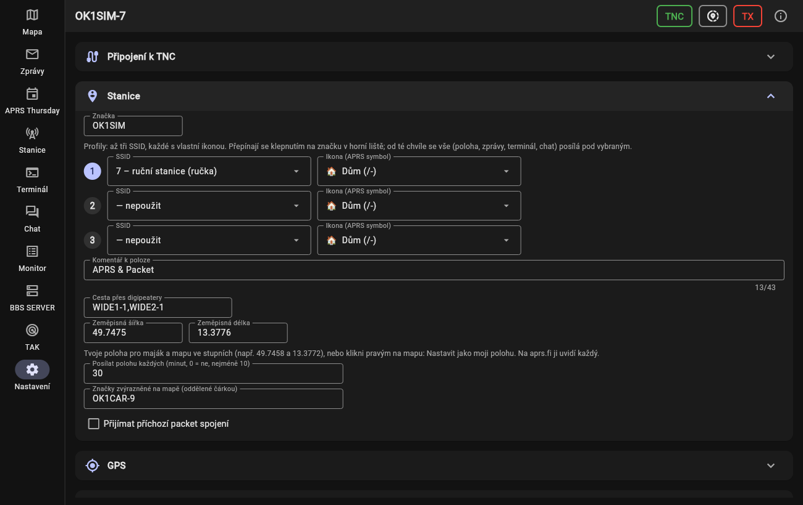

# APRS & Packet – samostatná aplikace

[English](README.md) · **Česky**

APRS stanice a packet radio terminál pro rádio s **KISS TNC** jako obyčejná aplikace pro počítač –
bez Home Assistantu, bez webového serveru. Je to samostatný sourozenec
[integrace APRS & Packet pro Home Assistant](https://github.com/michalsiman/aprs-kiss-ha) a sdílí
s ní rádiové jádro.

Dělaná pro Quansheng UV-K1/UV-K5 V3 s [firmwarem F4HWN](https://github.com/armel/uv-k1-k5v3-firmware-custom)
a jeho [aplikací KISS TNC](https://github.com/armel/uv-k1-k5v3-firmware-custom/wiki/App-KISS-TNC), ale funguje
s jakýmkoliv KISS TNC (Direwolf, hardwarové TNC, USB sériový port rádia nebo KISS TCP most z integrace).

**Stav: aktivní vývoj** – nové verze vycházejí často (viz [CHANGELOG](CHANGELOG.md), anglicky).
Sestavení pro **Linux** a **Windows**; **macOS** je v plánu, Android a iOS později (viz [Platformy](#platformy)).

## Co umí

- **Mapa** slyšených stanic (OpenStreetMap), vaše poloha, zvýrazněné sledované značky;
  popisky značek v rámečku a tlačítko *Tlumená mapa*, které mapu ztlumí, aby stanice vynikly
- **APRS zprávy** jako konverzace, opakované až do potvrzení, se stavem doručení;
  příchozí zprávy se potvrzují automaticky
- **#APRSThursday**: vlastní sekce pro čtvrteční síť HOTG přes ANSRVR – zapojení jedním tlačítkem,
  zprávy skupiny zvlášť mimo běžné zprávy, kdy začíná další akce, odhlášení ze skupiny
- **Stanice** slyšené rádiem nebo viděné na APRS-IS: vzdálenost, směr, komentář, počasí;
  objeví se i stanice, které iGate pošle z internetu do rádia (pakety třetí strany)
- **Packet terminál**: AX.25 spojení s BBS a nody, seznam **uložených BBS** k výběru,
  počet pokusů o připojení s tlačítkem *Zastavit připojování*, volitelně příchozí spojení
- **BBS SERVER**: vlastní packetová BBS na vaší značce s vlastním SSID – klasické příkazy W0RLI / MBL / FBB,
  osobní zprávy a bulletiny, nastavení a texty v obyčejných souborech (bbs.toml, welcome.txt, …),
  každá zpráva v jednom textovém souboru. Dokud běží, je všechno ostatní v aplikaci vypnuté (rádio je
  na kmitočtu BBS, nikdy ne na 144.800); zapnutí vyžaduje napsat potvrzovací větu.
  Viz **[návod k BBS SERVER](docs/BBS.cs.md)**
- **TAK**: aplikace jako TAK stanice přes rádio – polohy a GeoChat kompatibilní s ATAK (TAK Protocol v1
  v AX.25 UI rámcích), stanice na mapě barevně podle týmu, zprávy všem nebo jedné stanici.
  Stejně jako BBS SERVER vypne všechno ostatní. Viz **[specifikace TAK](docs/TAK.cs.md)**
- **USB GPS modul** (NMEA, u-blox/VK-172 a podobné, rychlost se zjistí sama): s fixem používá jeho polohu
  mapa, maják (i s výškou) a TAK; stav GPS v horní liště
- **Packet chat** (prostý text na CQ, QST, ALL nebo vám; automatické rámce jako DX hlášení
  digipeaterů do chatu nepatří; jak ho použít v jiném softwaru popisuje **[specifikace chatu](docs/CHAT.cs.md)**)
  a **monitor rámců** jako na TNC, který umí skrýt řádky z APRS-IS
- **APRS-IS** (internet) s volitelným iGate pro příjem i vysílání; zprávy, které vám iGate pošle
  rádiem, se přijmou a potvrdí
- Maják polohy, status, unproto
- 16 jazyků: brazilská portugalština, čeština, dánština, angličtina, francouzština, chorvatština,
  italština, němčina, norština (bokmål), polština, slovenština, slovinština, srbština (cyrilice),
  španělština, švédština a ukrajinština; řídí se jazykem systému, nebo si ho vyberete v Nastavení
- Dá vědět, když vyjde nová verze: nejvýš jednou denně se zeptá GitHubu na poslední vydání,
  nic o vás neposílá; v Nastavení se dá vypnout

> **Vysílání je ve výchozím stavu vypnuté.** *Vysílání* v horní liště zapněte jen tehdy, když máte
> radioamatérské oprávnění. APRS-IS jde zapnout až po napsání věty o licenci.

## Snímky obrazovky

Pořízené se simulovaným TNC (`tests/fake_tnc.py`); kliknutím se zvětší. Řídí se vzhledem vašeho
GitHubu, stejně jako aplikace, která používá světlý nebo tmavý režim systému.

<table>
<tr>
<td colspan="2"><a href="assets/cs/map.png"><picture><source media="(prefers-color-scheme: light)" srcset="assets/cs/map-light.png"></picture></a></td>
</tr>
<tr>
<td width="50%"><a href="assets/cs/messages.png"><picture><source media="(prefers-color-scheme: light)" srcset="assets/cs/messages-light.png"></picture></a></td>
<td width="50%"><a href="assets/cs/thursday.png"><picture><source media="(prefers-color-scheme: light)" srcset="assets/cs/thursday-light.png"></picture></a></td>
</tr>
<tr>
<td><a href="assets/cs/stations.png"><picture><source media="(prefers-color-scheme: light)" srcset="assets/cs/stations-light.png"></picture></a></td>
<td><a href="assets/cs/terminal.png"><picture><source media="(prefers-color-scheme: light)" srcset="assets/cs/terminal-light.png"></picture></a></td>
</tr>
<tr>
<td><a href="assets/cs/chat.png"><picture><source media="(prefers-color-scheme: light)" srcset="assets/cs/chat-light.png"></picture></a></td>
<td><a href="assets/cs/monitor.png"><picture><source media="(prefers-color-scheme: light)" srcset="assets/cs/monitor-light.png"></picture></a></td>
</tr>
<tr>
<td><a href="assets/cs/bbs.png"><picture><source media="(prefers-color-scheme: light)" srcset="assets/cs/bbs-light.png"></picture></a></td>
<td><a href="assets/cs/settings.png"><picture><source media="(prefers-color-scheme: light)" srcset="assets/cs/settings-light.png"></picture></a></td>
</tr>
</table>

## Instalace (Windows)

Stáhněte **`aprs-kiss-…-windows-x64-setup.exe`** z
[posledního vydání](https://github.com/michalsiman/aprs-kiss-app/releases/latest) a spusťte ho, nebo vezměte
**`…-windows-x64.zip`** a rozbalte ho kamkoliv. Rádio na USB se v Nastavení ukáže jako COM port.
macOS je v plánu, ale zatím se nesestavuje (není Mac, na kterém by se dal vyzkoušet).

## Instalace (Linux)

**S automatickými aktualizacemi (Flatpak):** otevřete
**[michalsiman.github.io/aprs-kiss-app](https://michalsiman.github.io/aprs-kiss-app/)** a klikněte na
*Instalovat*, nebo spusťte

```bash
flatpak install https://michalsiman.github.io/aprs-kiss-app/aprs-kiss.flatpakref
```

(Bez `--user`: Správce aktualizací a Správce softwaru v Linux Mintu vidí jen celosystémovou
instalaci, takže tam se aktualizace objeví.) Funguje na každé distribuci s Flatpakem (Linux Mint,
Fedora, Ubuntu s Flatpakem, …). Nové verze pak chodí spolu s ostatními aktualizacemi z vlastního
podepsaného Flatpak repozitáře (otisk klíče `0E31 685C C5D6 4B8C 7837  B62F 66ED ABD8 50DC 14BD`).

**Nebo si stáhněte balíček** z [posledního vydání](https://github.com/michalsiman/aprs-kiss-app/releases/latest)
a otevřete ho dvojklikem:

- **`aprs-kiss-…-x86_64.flatpak`**: stejný Flatpak jako jeden soubor; aktualizuje se také
  z repozitáře výše (vydání od 0.1.5).
- **`aprs-kiss_…_amd64.deb`**: Debian, Ubuntu, Linux Mint (22.04 / Debian 12 a novější).
- **`aprs-kiss-…-linux-x86_64.tar.gz`**: rozbalte kamkoliv a spusťte `./aprs-kiss`.

Žádný z nich nepotřebuje Python. Pro TNC na USB sériovém portu musí být váš uživatel ve skupině
`dialout`: `sudo usermod -aG dialout $USER`, pak se odhlaste a znovu přihlaste.

### S Pythonem

Python 3.10 nebo novější.

```bash
pipx install "aprs-kiss[desktop] @ git+https://github.com/michalsiman/aprs-kiss-app"
aprs-kiss
```

Nebo ze zdrojových kódů:

```bash
git clone https://github.com/michalsiman/aprs-kiss-app && cd aprs-kiss-app
python3 -m venv .venv && .venv/bin/pip install -e ".[dev]"
.venv/bin/flet run src/main.py      # nebo: .venv/bin/aprs-kiss
```

Při prvním spuštění se otevře **Nastavení**: zadejte svou značku, polohu a jak se dostat k TNC:

- **KISS přes TCP** – Direwolf (port 8001), nebo rádio sdílené po síti pomocí
  [`kiss_tcp_bridge.py`](https://github.com/michalsiman/aprs-kiss-ha/tree/main/bridge)
- **Sériový port** – rádio připojené k tomuto počítači; vyberte ho ze seznamu
  (názvy `/dev/serial/by-id/...` zůstanou stejné i po přepojení). Váš uživatel musí být ve skupině
  `dialout`: `sudo usermod -aG dialout $USER`, pak se odhlaste a znovu přihlaste.

Nastavení a historie zpráv jsou v `~/.local/share/aprs-kiss/` (změníte proměnnou `APRS_KISS_DATA`).

### Vyzkoušení bez rádia

```bash
.venv/bin/python tests/fake_tnc.py --port 8001 --mycall OK1SIM-7
```

Simulované TNC: každých pár sekund přijdou stanice, meteo hlášení a zprávy, potvrzuje vaše zprávy,
odpovídá v chatu a provozuje malou BBS (`OK0BBS`: H, L, B). Aplikaci nasměrujte na
`127.0.0.1:8001`.

### Balíčky

Workflow *Release packages* jednou spustí `flet build linux` a z výsledku udělá archiv, `.deb`
(`packaging/deb/build-deb.sh`) a Flatpak (`packaging/flatpak/`), které připojí ke každému vydání
`v*`. Položka do menu, AppStream metainfo a ikony jsou v `packaging/linux/`.

## Jak je postavená

```
src/
  aprs_kiss_core/   rádio, bez uživatelského rozhraní: KISS, AX.25 (UI i spojení), APRS,
                    APRS-IS/iGate, stanice (potvrzení, opakování, limity), BBS server (bbs/)
                    a Engine, který to spojuje a hlásí události posluchačům
  aprs_kiss_app/    uživatelské rozhraní ve Fletu: jedna obrazovka = jeden view
  main.py           vstupní bod pro `flet run` / `flet build`
tests/              testy jednotek, testy enginu proti fake_tnc.py
```

- **Flet** (Python, vykresluje Flutter): jeden kód pro počítač i mobil, nativní okno,
  žádný webový server.
- **Způsoby připojení jsou rozšiřitelné** (`aprs_kiss_core.connection.register_transport`): TCP
  a sériový port jsou vestavěné; USB na Androidu a Bluetooth TNC přibudou jako vlastní způsoby
  připojení bez zásahu do kódu KISS/AX.25.
- Moduly jádra jsou stejné jako v integraci pro Home Assistant (tam `hub.py`, tady `engine.py`).
  V plánu je vydat jádro jako jeden balíček, který budou používat obě.

## Platformy

| | Linux | Windows | macOS | Android | iOS |
|---|---|---|---|---|---|
| KISS přes TCP | ✅ | ✅ | v plánu | v plánu | v plánu |
| USB sériový port | ✅ | ✅ (COM porty) | v plánu | potřebuje USB host | ❌ (iOS) |
| Bluetooth TNC | – | – | – | v plánu | jen BLE |
| Běh na pozadí | ✅ | ✅ | ✅ | potřebuje službu na popředí | omezeno iOS |

## Testy

```bash
.venv/bin/python -m unittest discover -s tests -t .
```

## Autoři a licence

- Napsal [Michal Šiman](https://github.com/michalsiman) ([OK1SIM](https://ok1sim.cz/)) společně
  s [Claude Code](https://claude.com/claude-code).
- Uživatelské rozhraní [Flet](https://flet.dev) (Flutter), mapy [flutter_map](https://github.com/fleaflet/flutter_map)
  přes flet-map, mapová data © přispěvatelé OpenStreetMap.
- Zpracování APRS [aprslib](https://github.com/rossengeorgiev/aprs-python).
- [Firmware F4HWN](https://github.com/armel/uv-k1-k5v3-firmware-custom) pro Quansheng UV-K1/K5 V3 od **Armela F4HWN**,
  jeho [aplikace KISS TNC](https://github.com/armel/uv-k1-k5v3-firmware-custom/wiki/App-KISS-TNC) od **F4WAT**.

Licence MIT, viz [LICENSE](LICENSE).
