# APRS & Packet – standalone app

**English** · [Česky](README.cs.md)

[](https://github.com/michalsiman/aprs-kiss-app/releases/latest)
[](https://github.com/michalsiman/aprs-kiss-app/releases)
[](https://github.com/michalsiman/aprs-kiss-app/releases)
[](https://github.com/michalsiman/aprs-kiss-app/actions/workflows/tests.yml)
[](LICENSE)
[](#platforms)

[](https://www.python.org/)
[](https://flet.dev/)


<p align="center"><a href="assets/map.png"><picture><source media="(prefers-color-scheme: light)" srcset="assets/map-light.png">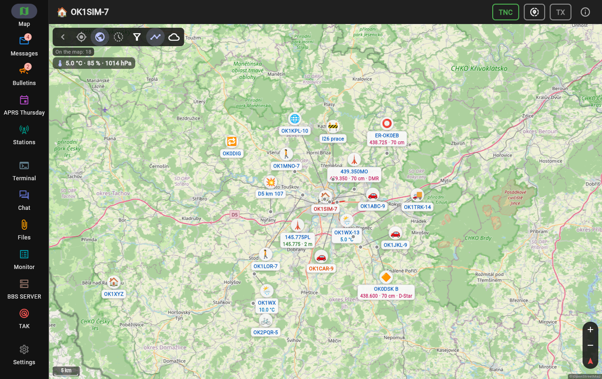</picture></a></p>

An APRS station and packet radio terminal for a radio with a **KISS TNC**, as a normal application for
computers and **Android phones** – no Home Assistant, no web server. It is the standalone sibling of the
[APRS & Packet Home Assistant integration](https://github.com/michalsiman/aprs-kiss-ha) and shares
its radio core.

Made for the Quansheng UV-K1/UV-K5 V3 with the [F4HWN firmware](https://github.com/armel/uv-k1-k5v3-firmware-custom)
and its [KISS TNC app](https://github.com/armel/uv-k1-k5v3-firmware-custom/wiki/App-KISS-TNC), but any KISS TNC works
(Direwolf, a hardware TNC, the radio's USB serial port, or the KISS TCP bridge from the integration).
Verified also with the **VGC VR-N76** and **AnyTone UV890** handhelds.

> **📻 VGC VR-N76 (and its twins BTECH UV-PRO, Radioddity GA-5WB):** tried on the air over Bluetooth with the
> radio's built-in KISS TNC – no cable, no extra TNC. **New in 1.4: the app tunes the radio** – type a
> frequency in *Settings › TNC connection* and tap *Tune* (firmware 0.7.11 or newer).

**Status: version 1.5, actively developed.** Stable versions (1.0, 1.1 … 1.5) now and then; between them
**beta versions** for testers – tick *Also offer beta versions* in Settings (see [CHANGELOG](CHANGELOG.md)).
Ready for **Linux**, **Windows** and **Android**; **macOS** and **iOS** builds exist but nobody has tried
them on a real Mac, iPhone or iPad yet – **testers wanted** (see [Platforms](#platforms)).

**Tried on the air** (thank you!): Linux and Windows with a **Quansheng** on a USB cable; Windows with a
**VGC VR-N76** and an **AnyTone 890** over Bluetooth; **Direwolf** over TCP/IP from another computer; the
Android **tracker** in a car with a Quansheng on a USB cable, and on its own over the internet (APRS-IS).
**New testers and feedback are very welcome** – any radio, any TNC, any platform: write an
[issue](https://github.com/michalsiman/aprs-kiss-app/issues).

## Features at a glance

<table>
<tr><td width="33%" valign="top"><h3>🗺️ Live map</h3>Stations with APRS symbols, trails, repeaters with their frequency; OpenStreetMap, OpenTopoMap or offline.</td><td width="33%" valign="top"><h3>✉️ Messages</h3>Conversations with unread counts and search; positions, links and mentioned stations open on the map.</td><td width="33%" valign="top"><h3>📧 Winlink e-mail</h3>Read and send e-mail over APRS through WLNK-1 – the login answered by itself.</td></tr>
<tr><td width="33%" valign="top"><h3>🚗 Tracker</h3>Fixed rate or SmartBeaconing-like; the map follows you like a navigation.</td><td width="33%" valign="top"><h3>⚠️ Warnings ahead</h3>Crashes, road works, fires, floods and oncoming stations in a lobe ahead of you.</td><td width="33%" valign="top"><h3>🆘 Mic-E & EMERGENCY</h3>Shorter positions with a status; EMERGENCY asked first and shown in red.</td></tr>
<tr><td width="33%" valign="top"><h3>🌡️ Weather around you</h3>The average of weather stations within 20 km in the map's corner.</td><td width="33%" valign="top"><h3>📻 Any KISS TNC</h3>TCP/IP, USB serial, Bluetooth and Bluetooth LE; tunes VR-N76 / UV-PRO radios.</td><td width="33%" valign="top"><h3>🔁 Digipeater & iGate</h3>Fill-in or wide digipeater; RX and TX iGate to APRS-IS.</td></tr>
<tr><td width="33%" valign="top"><h3>💻 Packet terminal</h3>AX.25 connected mode to BBSes and nodes, also over VARA FM.</td><td width="33%" valign="top"><h3>📁 Files</h3>Send and receive files over packet radio (YAPP), with progress and time left.</td><td width="33%" valign="top"><h3>🗄️ BBS SERVER</h3>Your own packet BBS – W0RLI / MBL / FBB style commands.</td></tr>
<tr><td width="33%" valign="top"><h3>🎯 TAK</h3>ATAK-compatible positions and GeoChat over the radio.</td><td width="33%" valign="top"><h3>🏔️ Spot & services</h3>SOTA, POTA, WWFF … self-spots; FIND, REPEAT, WXNOW and more.</td><td width="33%" valign="top"><h3>📅 #APRSThursday</h3>The weekly HOTG net on its own screen.</td></tr>
<tr><td width="33%" valign="top"><h3>🧭 Navigate & share</h3>Open any station or point in a navigation app, or share it.</td><td width="33%" valign="top"><h3>🌍 16 languages</h3>km or miles, °C or °F, hPa or inHg – as your phone or computer is set.</td><td width="33%" valign="top"><h3>🖥️ Everywhere</h3>Linux, Windows, macOS, Android, iOS – one app, light and dark.</td></tr>
</table>

## What it does

### APRS

- **Map** of heard stations (OpenStreetMap) with APRS symbols and framed callsign labels, your own
  position, tracked callsigns highlighted. Buttons to centre on you, a *Muted map* that fades the map
  so the stations stand out, stations from the internet on or off, *Last 2 hours* only, and a legend
  of the symbols – small icons that light up when on. Zoom buttons, a compass that turns the map north
  up again, a scale bar; two fingers turn the map only with a clear twist. **Menus stay open** while you tick their boxes or pick a map (an empty frame shows what is off); back or a tap outside closes them. Right-click (long press on a
  phone) the map: *Set as my position*. Only the stations around what is on screen are drawn, so the map
  stays quick also on a phone.
- **Online maps**: OpenStreetMap, or the **topographic OpenTopoMap** (contour lines, hill shading).
- **Offline map** bundled with the app: country borders, coastlines and about 1,000 bigger cities
  (Natural Earth); in Europe also motorways and main roads (Natural Earth), some 67,000 places of 1,000
  people and more and each country's 30 highest peaks (GeoNames) – more of them as you zoom in. Light in the dark mode too, like the online maps. One button switches to it; **with no internet the map
  switches to it by itself** and tells you so, and goes back to OpenStreetMap when the internet returns.
- **Map filters** (the funnel): only **weather stations**, only **moving** stations (moved in the last
  10 minutes; a station just heard stays until it is clear it stands still), only **repeaters**, only
  **warnings** (crashes, road works, fires, floods, fog, snow – in Czechia, the US, Australia, Portugal…) – any mix, remembered. In the same menu,
  **how far**: internet stations up to 20, 50 or 100 km (the APRS-IS server is asked for that area at once)
  and radio stations up to 20, 50, 100 km or with no limit. Under the map buttons a small line says how
  many stations are **on the map** right now; a tap on it tells the different callsigns and the nearest and
  furthest one (*Number of points on the map* in the map menu hides the line).
- **Repeaters show their frequency** right in their tag – band in colour (2 m green, 70 cm magenta) and the
  digital mode when the comment says it (DMR, D-Star, C4FM, NXDN, TETRA). **Weather stations show their
  temperature** in the same way.
- **Kilometres or miles, °C or °F, hPa or inHg** (Settings › App): as the phone or computer is set (miles in the
  US and the UK, Fahrenheit and inches of mercury in the US), or chosen. Distances, the map scale, the filter's
  how-far, speeds, altitudes, temperatures and pressure all follow it.
- **Temperature around you** in the map's corner: the average of the weather stations within 20 km
  (reports up to 2 hours old), with humidity and pressure when they send them; updated every 5 minutes,
  moves under the map buttons while they are open, switched off in the map menu. A tap on it lists the stations
  it comes from: their values, how far and in which direction, how old.
- **Markers never cover each other**: stations at one place or close together move apart, a thin grey line
  leads from the middle of the symbol to a dot where the station really is – the lines never cross and no
  dot hides under another station's symbol. **Trails** (the last half hour,
  also your own from the GPS), APRS **objects** as places of their own, impossible jumps ignored.
  **Measure a distance** by a long press on two points.
- **Navigation-like map while the tracker runs**: you stay in the middle at a street zoom; move the map and
  a **Back to me** button counts down 15 s, then the map comes back by itself.
- **Warnings ahead while the tracker runs** (off until you switch them on): **warnings** and
  **other moving stations** (going your way, coming towards you or crossing) in a lobe ahead of you –
  long and narrow when you drive fast, wide in town, never behind; a bubble and a sound.
- **Profiles**: up to three SSIDs of your callsign, each with its own symbol (car, handheld, home), comment
  and tracker way; the top bar shows the active one's symbol next to the callsign, a tap on it switches –
  position, messages, terminal, everything goes under it.
- **APRS-IS**: one switch sends your position (now, regular, tracker) and messages over the internet too;
  with transmitting off it all goes over the internet only.
- **Mic-E**: the position shorter on air, with a status – and **EMERGENCY** (asked first, a red SOS in the top
  bar until ended); stations in emergency stand out in red on the map.
- **Tracker**: the position button in the top bar sends your position once, or starts the tracker (▶) –
  your GPS position then goes out by itself, at a fixed interval or **smart (SmartBeaconing)** like the APRS
  and LoRa APRS trackers: rarely when standing, more often the faster you go, at once on a turn; course and
  speed included. It sends by radio while TX is on (and over the internet when chosen).
- **Your own offline map** (Settings › Offline maps): import a better map, e.g. a topographic one, from
  wherever you get it – raster tile maps in **MBTiles, PMTiles, SQLiteDB** (OsmAnd, Locus), a **ZIP** of z/x/y
  tiles, or a ZIP/7z with such files inside (7z on a computer with 7-Zip). Several maps at once; the map
  button chooses between *online*, *imported* and *basic offline*. Vector maps (Mapsforge, vector MBTiles)
  are not supported.
- **Messages** as conversations: each with a **coloured circle and a letter** (the suffix's first, OK1ABC → A)
  and a **red count of its unread messages**; **All / Unread** filters with their counts and a **search** in
  callsigns and texts (case and accents ignored); *⋮ › Mark all as read*. Unread stays unread after a restart
  or an update. Retried until acknowledged, delivery state shown, incoming messages acknowledged
  automatically; a new message to any callsign with the round **+**. **Radio and internet** are two icons
  (a walkie-talkie and a globe), one or both, remembered. A longer text goes as several messages numbered
  1/2, 2/2 …; the conversation shows how far the station is (and how far it was when each message came) with a
  button to see it on the map; back from a conversation goes to the list first; conversations can be deleted.
- **Notifications** of a new message or chat line while you are not looking: on Android in the background (a
  tap opens the conversation; it says how many messages are unread in all), on Linux, Windows and macOS while
  the window is not in front.
- **Stations a message mentions** (OK6DJ-6 in a WXNOW answer, "say hi to OK1ABC"): a small button at the
  message lists those heard with a position, how far and which way they are; a tap shows one on the map.
- **Web links** in messages, APRS Thursday and the chat are clickable; a tap first shows where the link leads
  and warns that nobody vouches for the page (it may be harmful).
- **Navigate here / Share this place** for a station or any point on the map: a navigation or map app on the
  phone (Android asks which one), or the share sheet to send it on; a web map and a copied text on a computer.
- **Positions in messages and the chat**: send yours, or any place picked on the map – as coordinates or as
  a Maidenhead locator (the map's menu shows the locator of every place); a position written in a message
  or a chat line (decimal degrees, degrees and minutes, APRS's own, a locator) opens on the map with a pin.
- **Spotting an activation** (Messages › Spot): SOTA, POTA, WWFF, SIOTA, GMA, WCA castles, IOTA and
  lighthouses – a self-spot goes by radio as an APRS message to APRS2SOTA, Camilla (GMA) or APSPOT, checked
  and shortened to fit, with the gateway's answer in its conversation.
- **Winlink e-mail** (APRSLink, WLNK-1): log in with one button (only three characters of the Winlink password
  go on air), list, read, reply, forward and delete e-mails, write a new one line by line – all as APRS messages.
- **Services on APRS** (Messages › Services): FIND (where a station was last heard), REPEAT (the nearest
  repeaters), WXNOW (the nearest weather), UTC, satellite passes and sunrise (9M2PJU-4), e-mail (MAILMY) –
  a tap puts the command in a message, the answer comes back as one.
- **#APRSThursday**: its own section for the weekly HOTG net through ANSRVR – check in with one
  button, read the group's messages apart from your inbox (ANSRVR's relays never land in Messages), see when
  the next net starts, leave the group; by radio, internet or both, remembered.
- **Stations** heard on the radio or seen on APRS-IS: distance, direction, comment, weather, the path;
  in order of last heard, distance or callsign; a filter and a legend; the count says how many are shown of all, and an empty list says why. A station's
  details offer the map, a message and the **callbooks** (QRZ.com, HamQTH, QRZCQ – the base callsign – and aprs.fi). Stations an iGate relays from the internet by radio (third-party packets)
  show up too.
- **Position beacon** every N minutes and a *Send position now* button in the top bar; status and
  unproto. Icon (APRS symbol), comment, SSID and path in Settings.
- **Digipeater**: fill-in (WIDE1-1, for a home station) or full (WIDEn-N with a hop limit), frames
  addressed to your callsign or aliases (e.g. RELAY), the same packet only once in 30 seconds.
- **APRS-IS** (internet) with an optional RX and TX **iGate**; messages an iGate relays to you by
  radio are received and acknowledged.
- **Your position from a GPS**: the phone's own GPS (the default on a phone with no position typed in;
  Settings shows where it says you are), or a **USB GPS module** (NMEA, u-blox/VK-172 and the like, speed found automatically): with a fix the map,
  the beacon (with altitude) and TAK use its position; the GPS state is shown in the top bar.

### Packet radio

- **Terminal**: AX.25 connected mode to BBSes and nodes, through digipeaters if you like; a list of
  **saved BBSes** to pick from; the connect attempts with their times and a *Stop connecting* button;
  optional incoming connections.
- **Terminal over VARA FM**: the same terminal over VARA FM instead of AX.25 – *Connection: VARA FM*.
  VARA runs on its own (Windows, or Wine on Linux) with the radio on a sound card such as an AIOC cable;
  the app talks to it over its TCP interface (ports 8300/8301) and shows its progress, PTT and the
  transmit buffer.
- **Files**: send a file to another station and receive files over packet radio – YAPP (the standard of
  BPQ, WinPack, Paxon) over a connected AX.25 link; a time estimate before sending, progress, speed and the
  time left while it runs; every incoming file is offered first; an interrupted transfer resumes.
- **Chat**: plain text to CQ, QST, ALL or you, heard by everybody on the frequency; automatic frames
  such as digipeater DX reports stay out. See the **[chat specification](docs/CHAT.md)** to use it
  from other software.
- **Monitor**: every frame received and sent, TNC style, with pause and clear; it can hide the APRS-IS
  lines, and shows TAK frames decoded.
- **BBS SERVER**: run your own packet BBS on your callsign with its own SSID – classic W0RLI / MBL / FBB
  commands, personal messages and bulletins, limits for clients, idle time, airtime and stored messages;
  settings and texts in plain files (bbs.toml, welcome.txt, …), one text file per message. While it runs,
  everything else in the app is off (the radio sits on the BBS frequency, never on 144.800); switching
  it on takes a typed confirmation. See the **[BBS SERVER guide](docs/BBS.md)**.
- **TAK**: the app as a TAK station over the radio – ATAK-compatible positions and GeoChat (TAK Protocol v1
  in AX.25 UI frames), its own map with the stations coloured by team, a list of stations, messages to
  everybody or one station, your team, role and callsign in Settings; who appeared on the map and who
  moved how far is shown in GeoChat. On a phone the map and GeoChat are two screens, with the number of
  unread messages on the GeoChat icon. Its frames fit LoRa KISS modems too (MeshCore). Like BBS SERVER
  it switches everything else off. See the **[TAK specification](docs/TAK.md)**.

### The app

- **The menu in sections**: APRS (map, messages, APRS Thursday, stations), packet radio (terminal, chat,
  files, monitor, BBS, TAK) and the settings – headings in the phone's menu, gaps on a computer.
- **Top bar as a dashboard**, on a computer and on a phone: **TNC**, **IS** and **GPS** lamps green when
  working, the position / tracker button, **TX** with a red frame while transmitting is on and all red while
  a frame goes out on air (IS red for a second when something goes to APRS-IS). On a computer the lamps
  are larger and tell their state when you point at them; on a phone TNC, IS and GPS share one small block
  so the whole callsign fits.
- **Four ways to the TNC**: **KISS over TCP/IP** (Direwolf, a network bridge, a Wi-Fi TNC), a **serial/USB
  port** (the list shows the ports, with stable `/dev/serial/by-id` names on Linux; on a phone the USB port
  through an OTG cable), **Bluetooth** (a paired TNC or radio, serial port profile) and **Bluetooth LE** (KISS
  over BLE); TX delay for the TNC; reconnects by itself.
- **Sound-card modem (Direwolf)** on a computer: no TNC needed – a radio on a sound card (AIOC, DigiRig,
  SignaLink…); the app sets Direwolf up (sound card, PTT by VOX, CM108 or a serial port), starts and stops it.
- **Tune the radio from the app**: radios with a built-in KISS TNC over Bluetooth – **VGC VR-N76, BTECH
  UV-PRO, Radioddity GA-5WB** (firmware 0.7.11+) – take a frequency from *Settings › TNC connection*
  (*Tune*, and *Its own* to go back), through the KISS SetHardware command. The power cannot be set this way.
- In **16 languages**: Brazilian Portuguese, Croatian, Czech, Danish, English, French, German, Italian,
  Norwegian (Bokmål), Polish, Serbian (Cyrillic), Slovak, Slovenian, Spanish, Swedish and Ukrainian;
  it follows the system language or you pick one in Settings.
- **Light and dark** appearance, following the system or chosen in Settings.
- **Sounds**: a beep when the radio transmits, sounds for a new APRS message, chat line and TAK GeoChat
  message – each on or off in Settings.
- **Keep the screen on**: never, while TAK runs, or always.
- **Settings in folded blocks**; the callsign is required (framed red until it is saved). The
  confirmation sentences (TAK, BBS SERVER, the licence for APRS-IS) are typed once, not every time.
- **The first start** asks for the language (the device's is offered) and shows a warning that has to
  be accepted: transmitting needs an amateur radio licence.
- Tells you when a new version is out: asks GitHub at most once a day for the latest release,
  sends nothing about you; can be switched off in Settings. On Android *Download* fetches the new .apk.
- **A log for finding faults**: *About › Copy log* puts the end of a small log in the clipboard (what went
  on before a freeze; a watchdog writes down what blocks the app). On a phone, when Android restarts the
  app's screen part in the background, it comes back on the screen you had open.

### On a phone (Android)

- The screens are in a menu that slides in from the side (☰); the top bar is a dashboard: **TNC**, **IS**
  and **GPS** lamps green when working, **TX** with a red frame while transmitting is on and all red while
  a frame goes out on air – a tap on TX switches transmitting, a tap on TNC or GPS tells their state.
- **The TNC on the phone's USB port** (OTG cable): the Quansheng with the F4HWN KISS firmware and other
  CDC-ACM TNCs, CP210x and FTDI cables; **over Bluetooth** (a paired TNC or radio with the serial port
  profile, e.g. Mobilinkd TNC3 or a handheld with a Bluetooth KISS TNC); **over Bluetooth LE** (KISS over
  BLE: a LoRa APRS tracker, Mobilinkd TNC4, PicoAPRS …, found by a scan in Settings); or over the network.
- **The phone's GPS** as your position.
- **Running in the background** (Settings › Background and screen): receiving, beacons, messages and TAK
  go on when the app is not on screen or the phone is locked, with a notification.

> **Transmitting is off by default.** Switch *Transmit* on in the top bar only if you hold an amateur
> radio licence. APRS-IS can be switched on only after typing the licence statement.

## Screenshots

Taken with the simulated TNC (`tests/fake_tnc.py --scene --tak`, `tools/screenshots.py`); click for
full size. They follow your GitHub theme, and so does the app: it uses the system's light or dark mode.

### On a phone

<table>
<tr><td width="33%" align="center"><a href="assets/phone-map.png"><picture><source media="(prefers-color-scheme: light)" srcset="assets/phone-map-light.png"></picture></a><br><b>The map</b></td><td width="33%" align="center"><a href="assets/phone-filter.png"><picture><source media="(prefers-color-scheme: light)" srcset="assets/phone-filter-light.png">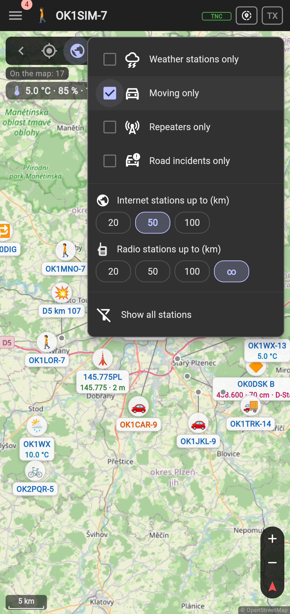</picture></a><br><b>Filters and how far</b></td><td width="33%" align="center"><a href="assets/phone-menu.png"><picture><source media="(prefers-color-scheme: light)" srcset="assets/phone-menu-light.png">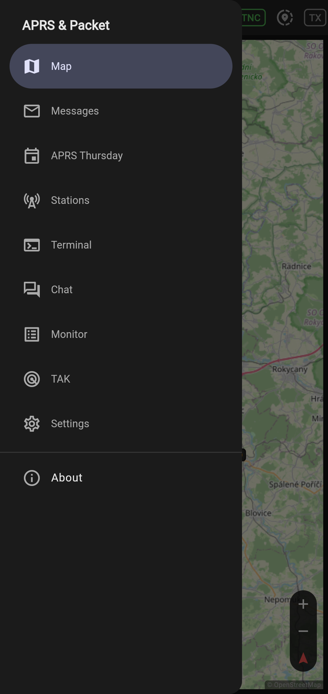</picture></a><br><b>The menu in sections</b></td></tr>
<tr><td width="33%" align="center"><a href="assets/phone-messages.png"><picture><source media="(prefers-color-scheme: light)" srcset="assets/phone-messages-light.png">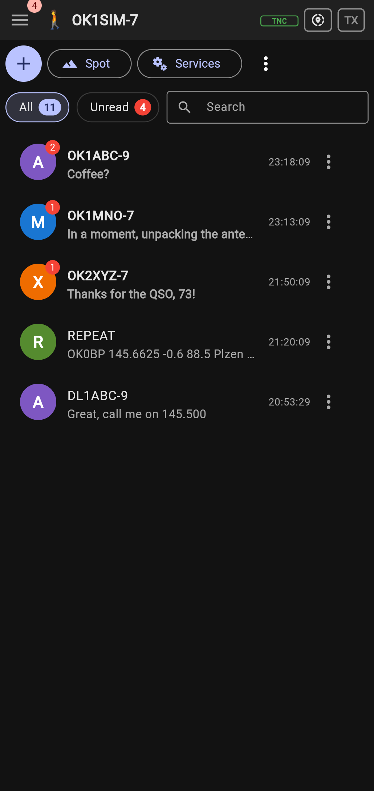</picture></a><br><b>Messages</b></td><td width="33%" align="center"><a href="assets/phone-profiles.png"><picture><source media="(prefers-color-scheme: light)" srcset="assets/phone-profiles-light.png">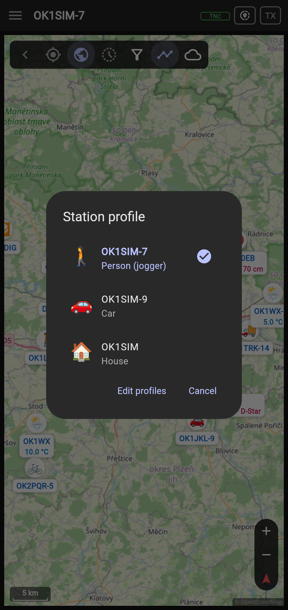</picture></a><br><b>Profiles (SSIDs)</b></td><td width="33%" align="center"><a href="assets/phone-tnc.png"><picture><source media="(prefers-color-scheme: light)" srcset="assets/phone-tnc-light.png">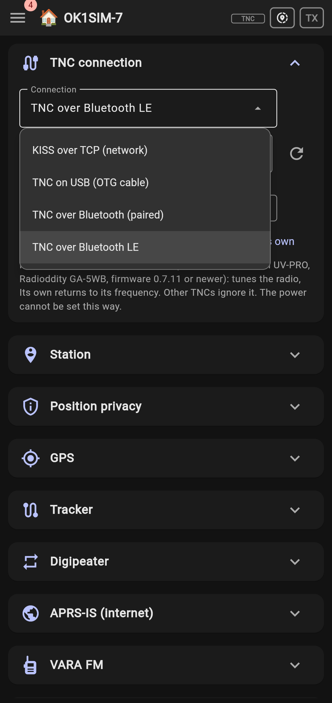</picture></a><br><b>TNC: TCP/IP, USB, Bluetooth, BLE</b></td></tr>
<tr><td width="33%" align="center"><a href="assets/phone-settings.png"><picture><source media="(prefers-color-scheme: light)" srcset="assets/phone-settings-light.png">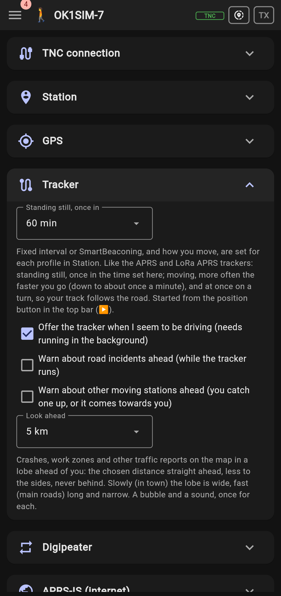</picture></a><br><b>Settings</b></td><td width="33%" align="center"><a href="assets/phone-tak.png"><picture><source media="(prefers-color-scheme: light)" srcset="assets/phone-tak-light.png">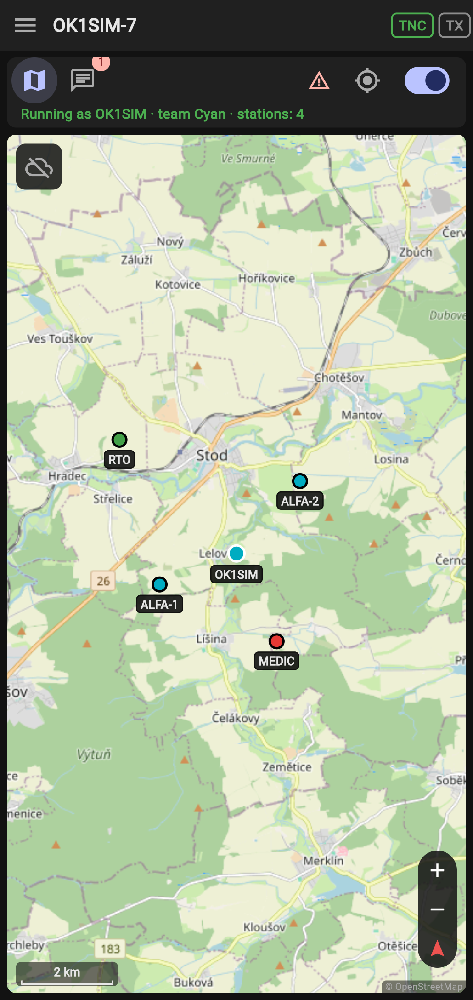</picture></a><br><b>TAK map</b></td><td width="33%" align="center"><a href="assets/phone-tak-chat.png"><picture><source media="(prefers-color-scheme: light)" srcset="assets/phone-tak-chat-light.png"></picture></a><br><b>TAK GeoChat</b></td></tr>
</table>

### On a computer

<table>
<tr>
<td colspan="2"><a href="assets/map.png"><picture><source media="(prefers-color-scheme: light)" srcset="assets/map-light.png"></picture></a><br><sub>Map: symbols, repeaters with their frequency, a road incident, trails</sub></td>
</tr>
<tr>
<td width="50%"><a href="assets/map-filter.png"><picture><source media="(prefers-color-scheme: light)" srcset="assets/map-filter-light.png">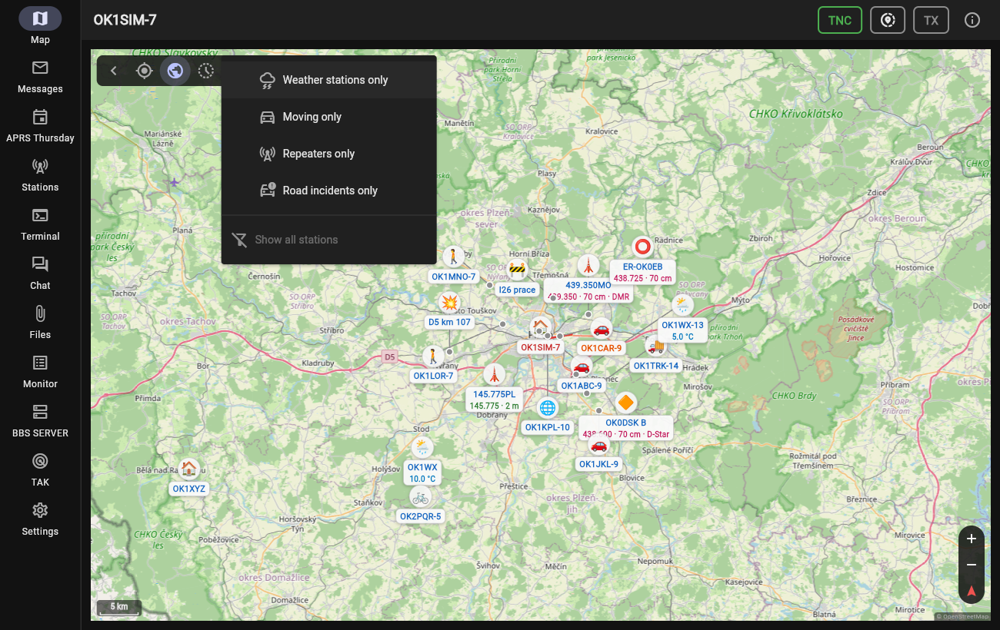</picture></a><br><sub>Map filters: the menu stays open while you tick</sub></td>
<td width="50%"><a href="assets/map-repeaters.png"><picture><source media="(prefers-color-scheme: light)" srcset="assets/map-repeaters-light.png">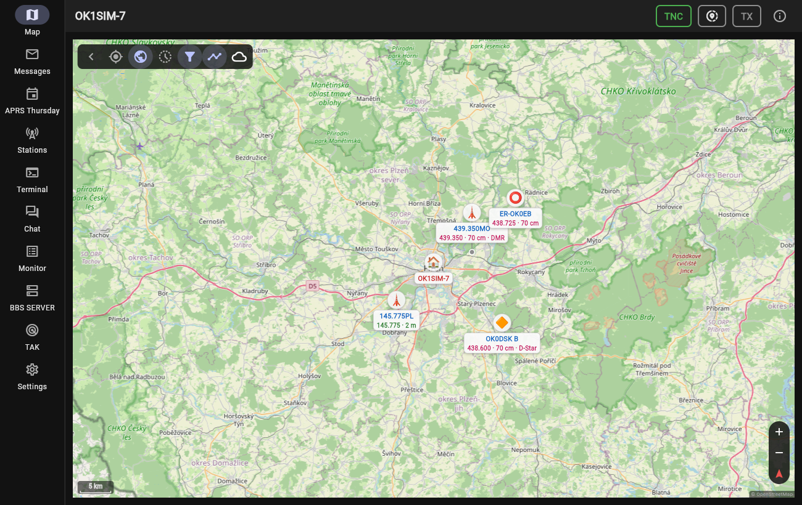</picture></a><br><sub>Only repeaters, with frequency, band and mode</sub></td>
</tr>
<tr>
<td width="50%"><a href="assets/map-source.png"><picture><source media="(prefers-color-scheme: light)" srcset="assets/map-source-light.png">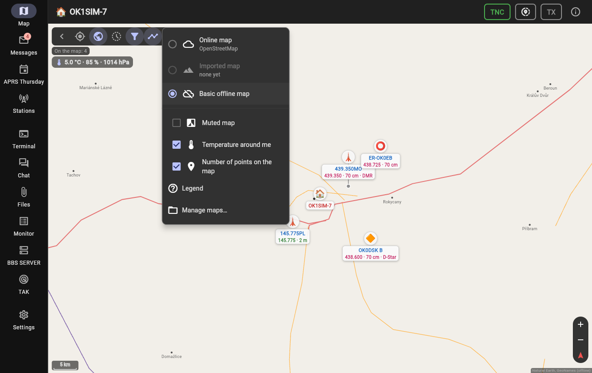</picture></a><br><sub>Choosing the map: online, imported, basic offline</sub></td>
<td width="50%"><a href="assets/map-offline.png"><picture><source media="(prefers-color-scheme: light)" srcset="assets/map-offline-light.png"></picture></a><br><sub>Basic offline map (no internet needed)</sub></td>
</tr>
<tr>
<td width="50%"><a href="assets/messages.png"><picture><source media="(prefers-color-scheme: light)" srcset="assets/messages-light.png"></picture></a><br><sub>Messages: conversations with unread counts, filters and search</sub></td>
<td width="50%"><a href="assets/messages-unread.png"><picture><source media="(prefers-color-scheme: light)" srcset="assets/messages-unread-light.png">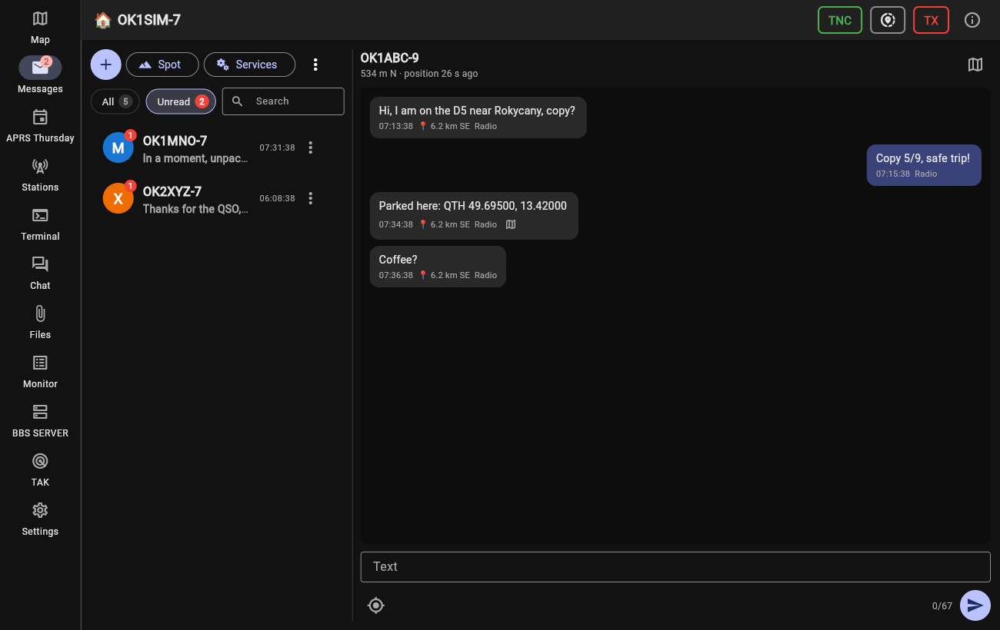</picture></a><br><sub>Only the unread conversations</sub></td>
</tr>
<tr>
<td width="50%"><a href="assets/tracker-menu.png"><picture><source media="(prefers-color-scheme: light)" srcset="assets/tracker-menu-light.png">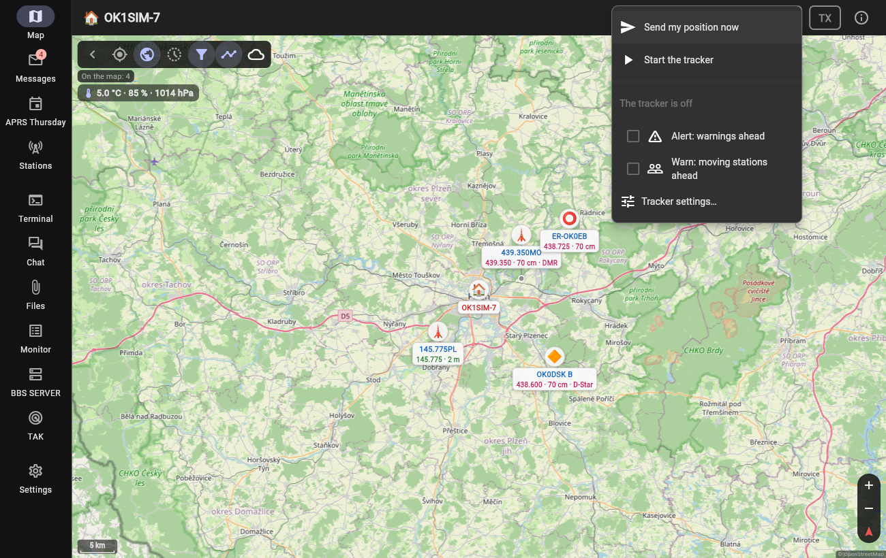</picture></a><br><sub>The position and tracker menu</sub></td>
<td width="50%"><a href="assets/station.png"><picture><source media="(prefers-color-scheme: light)" srcset="assets/station-light.png">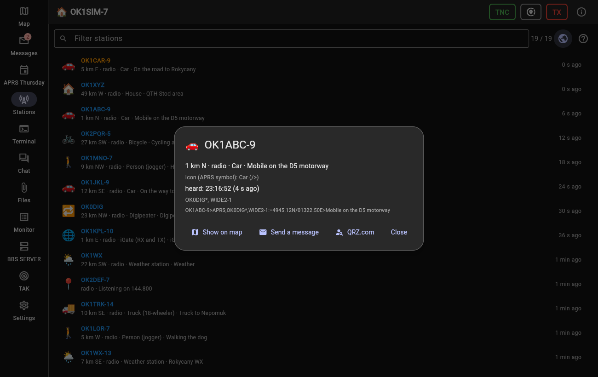</picture></a><br><sub>A station's details: map, message, callbooks</sub></td>
</tr>
<tr>
<td width="50%"><a href="assets/thursday.png"><picture><source media="(prefers-color-scheme: light)" srcset="assets/thursday-light.png"></picture></a><br><sub>#APRSThursday</sub></td>
<td width="50%"><a href="assets/stations.png"><picture><source media="(prefers-color-scheme: light)" srcset="assets/stations-light.png">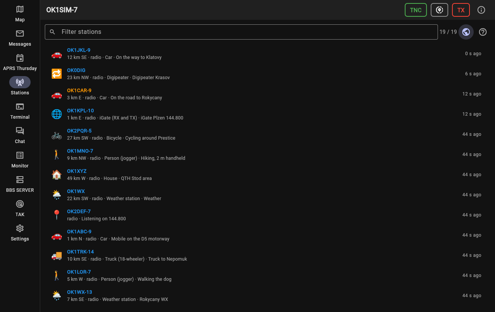</picture></a><br><sub>Stations with distance and direction</sub></td>
</tr>
<tr>
<td width="50%"><a href="assets/terminal.png"><picture><source media="(prefers-color-scheme: light)" srcset="assets/terminal-light.png"></picture></a><br><sub>Terminal: connected to a BBS over AX.25</sub></td>
<td width="50%"><a href="assets/chat.png"><picture><source media="(prefers-color-scheme: light)" srcset="assets/chat-light.png">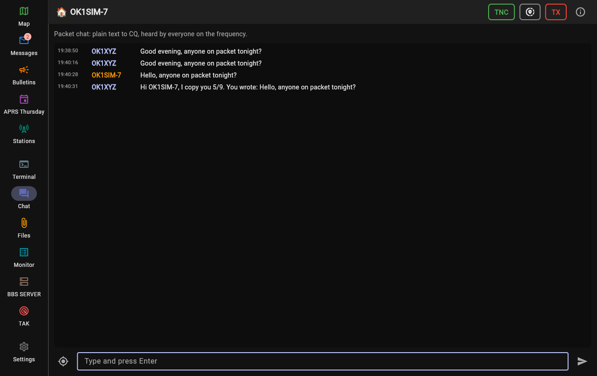</picture></a><br><sub>Packet chat</sub></td>
</tr>
<tr>
<td width="50%"><a href="assets/monitor.png"><picture><source media="(prefers-color-scheme: light)" srcset="assets/monitor-light.png"></picture></a><br><sub>Frame monitor</sub></td>
<td width="50%"><a href="assets/settings-tracker.png"><picture><source media="(prefers-color-scheme: light)" srcset="assets/settings-tracker-light.png">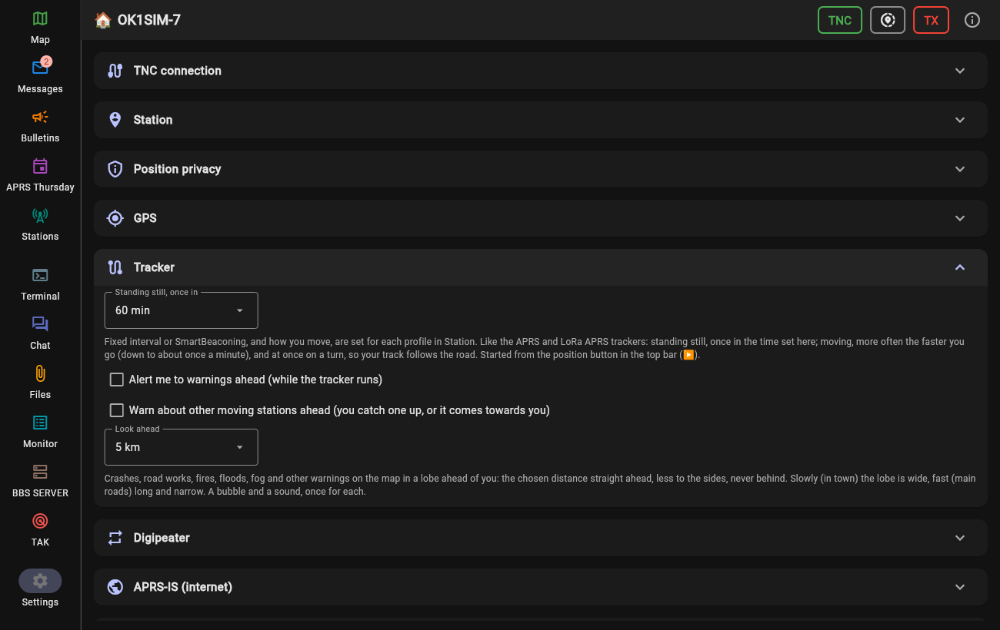</picture></a><br><sub>Tracker and warnings ahead</sub></td>
</tr>
<tr>
<td width="50%"><a href="assets/files.png"><picture><source media="(prefers-color-scheme: light)" srcset="assets/files-light.png">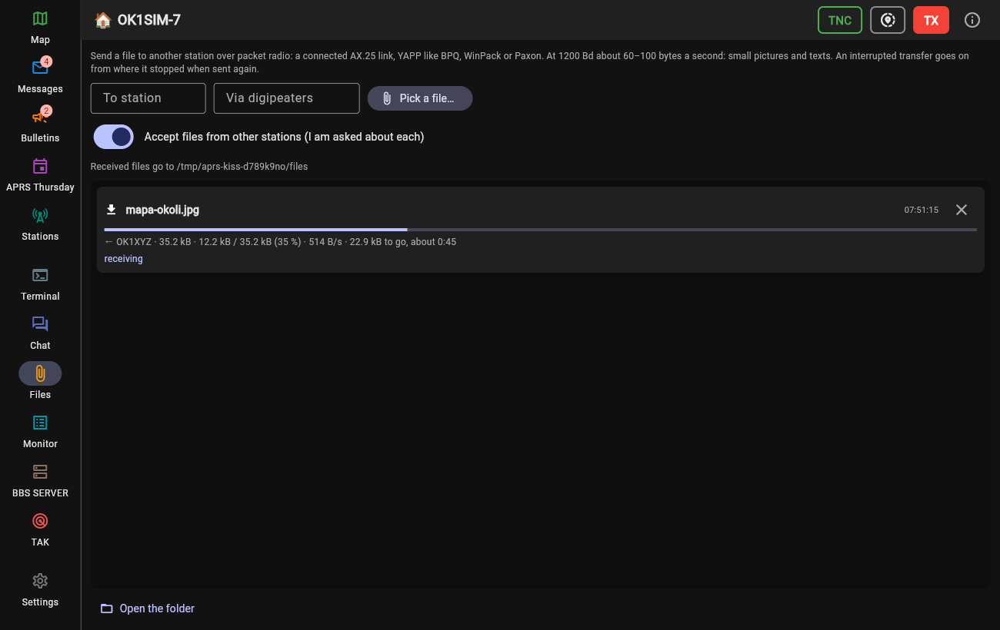</picture></a><br><sub>Files: a picture coming in over packet radio, progress and time left</sub></td>
<td width="50%"><a href="assets/files-offer.png"><picture><source media="(prefers-color-scheme: light)" srcset="assets/files-offer-light.png">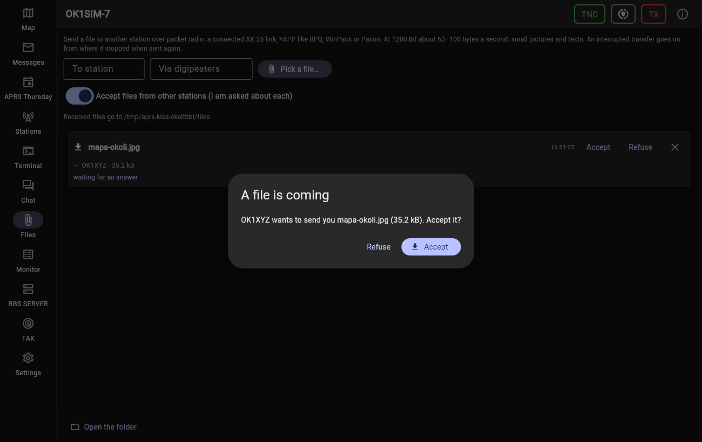</picture></a><br><sub>A file from another station is offered first</sub></td>
</tr>
<tr>
<td colspan="2"><a href="assets/tak.png"><picture><source media="(prefers-color-scheme: light)" srcset="assets/tak-light.png">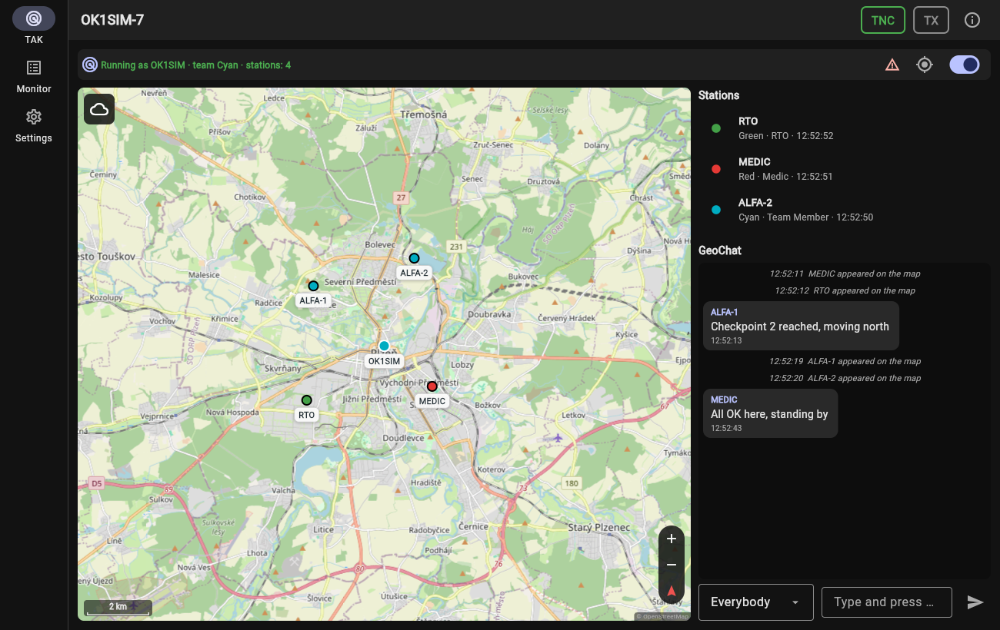</picture></a><br><sub>TAK: stations by team and GeoChat</sub></td>
</tr>
<tr>
<td width="50%"><a href="assets/bbs.png"><picture><source media="(prefers-color-scheme: light)" srcset="assets/bbs-light.png"></picture></a><br><sub>BBS SERVER</sub></td>
<td width="50%"><a href="assets/bbs-confirm.png"><picture><source media="(prefers-color-scheme: light)" srcset="assets/bbs-confirm-light.png">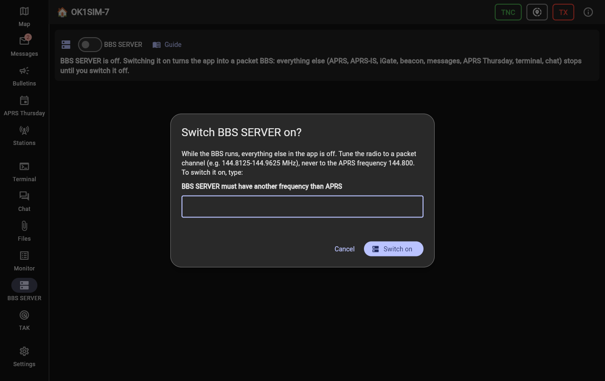</picture></a><br><sub>BBS SERVER is switched on with a typed sentence</sub></td>
</tr>
<tr>
<td width="50%"><a href="assets/settings.png"><picture><source media="(prefers-color-scheme: light)" srcset="assets/settings-light.png"></picture></a><br><sub>Settings: station and profiles</sub></td>
<td width="50%"><a href="assets/settings-tnc.png"><picture><source media="(prefers-color-scheme: light)" srcset="assets/settings-tnc-light.png">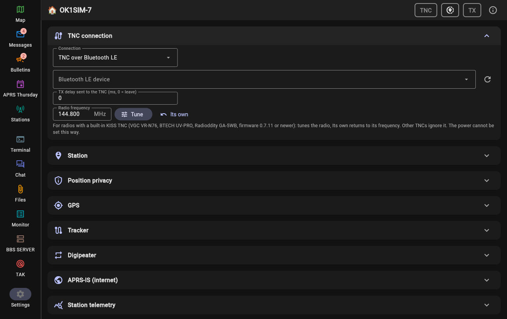</picture></a><br><sub>TNC over Bluetooth LE, and the radio's frequency (VR-N76, UV-PRO, GA-5WB)</sub></td>
</tr>
<tr>
<td colspan="2"><a href="assets/settings-more.png"><picture><source media="(prefers-color-scheme: light)" srcset="assets/settings-more-light.png">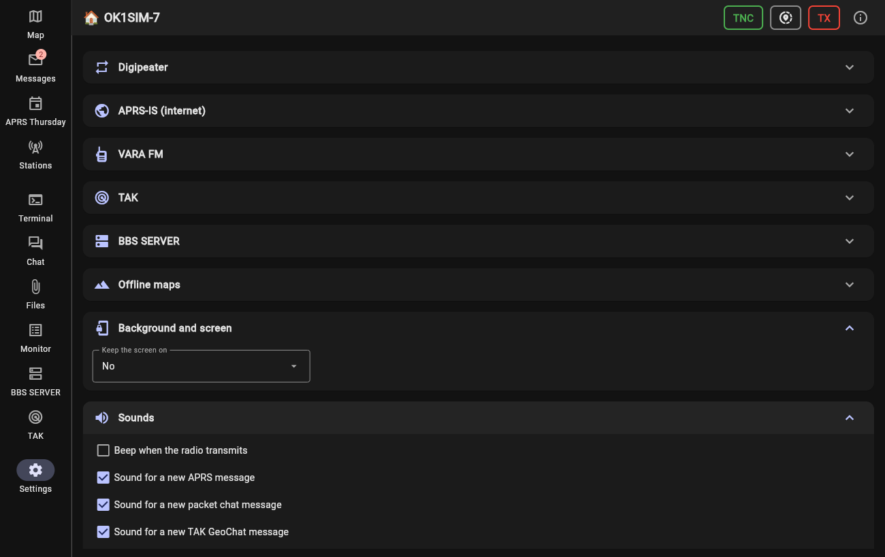</picture></a><br><sub>Settings: background and screen, sounds</sub></td>
</tr>
</table>

## Install (Windows)

Download **`aprs-kiss-…-windows-x64-setup.exe`** from the
[latest release](https://github.com/michalsiman/aprs-kiss-app/releases/latest) and run it, or take the
**`…-windows-x64.zip`** and unpack it anywhere. The radio on USB shows up as a COM port in Settings.

## Install (macOS)

Download **`aprs-kiss-…-macos.dmg`** from the
[latest release](https://github.com/michalsiman/aprs-kiss-app/releases/latest), open it and drag
*APRS & Packet* to Applications. The app is not signed by Apple (no paid developer account), so the
first time **right-click it › Open › Open**, or allow it in *System Settings › Privacy & Security ›
Open Anyway*. The radio on USB shows up as `/dev/cu.usbserial…` / `/dev/cu.usbmodem…` in Settings.
The macOS build is made on GitHub without a Mac to try it on – **testers wanted**: tell us in the
[issues](https://github.com/michalsiman/aprs-kiss-app/issues) how it went.

## Install (Android)

Download **`aprs-kiss-…-android.apk`** on the phone from the
[latest release](https://github.com/michalsiman/aprs-kiss-app/releases/latest) and open it; Android asks
to allow installing apps from the browser or file manager once. On the phone the app reaches the TNC
**on the phone's USB port** (Settings › Connection: TNC on USB, through an OTG cable or adapter; the
Quansheng with the F4HWN KISS firmware and other CDC-ACM TNCs, CP210x and FTDI cables; Android asks once
to allow the app to use it) or **over the network (KISS over TCP)**: Direwolf on a computer, the radio
shared with [`kiss_tcp_bridge.py`](https://github.com/michalsiman/aprs-kiss-ha/tree/main/bridge), or a
Wi-Fi TNC. The screens fit a phone and are switched in a menu that slides in from the side (☰). Your position can come
from **the phone's GPS** (Settings › GPS). BBS SERVER and USB GPS modules are for computers only.
The .apk is signed with the project's own key, so a new version installs over the previous one (from
0.1.30 on; an older one has to be uninstalled once); the app tells you when one is out and downloads it.
A Google Play release is being prepared.

## Install (iPhone, iPad)

Apple lets apps onto an iPhone only through the App Store or signed by a developer account, which this
project does not have. The release has an **unsigned `aprs-kiss-…-ios-unsigned.ipa`** that you can put on
your device with a sideloading tool such as [AltStore](https://altstore.io/) or
[Sideloadly](https://sideloadly.io/), which signs it with your own Apple ID (with a free Apple ID it has
to be refreshed every 7 days). The TNC is reached over the network or over **Bluetooth LE** (KISS over
BLE – iOS lets apps use no classic serial Bluetooth).
**Not tried on a real iPhone or iPad yet – testers wanted:** if you can try it, please tell us how it went
in the [issues](https://github.com/michalsiman/aprs-kiss-app/issues).

## Install (Linux)

**With automatic updates (Flatpak):** open
**[michalsiman.github.io/aprs-kiss-app](https://michalsiman.github.io/aprs-kiss-app/)** and click
*Install*, or run

```bash
flatpak install https://michalsiman.github.io/aprs-kiss-app/aprs-kiss.flatpakref
```

(Without `--user`: Linux Mint's Update Manager and Software Manager only see the system-wide
installation, so that is where the updates show up.) It works on any distribution with Flatpak (Linux Mint, Fedora, Ubuntu with Flatpak, …). New versions
then come with your other updates, from our own signed Flatpak repository
(key fingerprint `0E31 685C C5D6 4B8C 7837  B62F 66ED ABD8 50DC 14BD`).

**Or download a package** from the [latest release](https://github.com/michalsiman/aprs-kiss-app/releases/latest)
and double-click it:

- **`aprs-kiss-…-x86_64.flatpak`**: the same Flatpak as a single file; it also updates from the
  repository above (releases from 0.1.5 on).
- **`aprs-kiss_…_amd64.deb`**: Debian, Ubuntu, Linux Mint (22.04 / Debian 12 and newer).
- **`aprs-kiss-…-linux-x86_64.tar.gz`**: unpack anywhere and run `./aprs-kiss`.

None of them needs Python. For a TNC on a USB serial port your user needs to be in the `dialout`
group: `sudo usermod -aG dialout $USER`, then log in again.

### With Python

Python 3.10 or newer.

```bash
pipx install "aprs-kiss[desktop] @ git+https://github.com/michalsiman/aprs-kiss-app"
aprs-kiss
```

Or from a checkout:

```bash
git clone https://github.com/michalsiman/aprs-kiss-app && cd aprs-kiss-app
python3 -m venv .venv && .venv/bin/pip install -e ".[dev]"
.venv/bin/flet run src/main.py      # or: .venv/bin/aprs-kiss
```

The first start opens **Settings**: set your callsign, your position and how to reach the TNC:

- **KISS over TCP** – Direwolf (port 8001), or the radio shared on the network with
  [`kiss_tcp_bridge.py`](https://github.com/michalsiman/aprs-kiss-ha/tree/main/bridge)
- **Serial port** – the radio plugged into this computer; pick it from the list
  (`/dev/serial/by-id/...` names stay the same after replugging). Your user needs to be in the
  `dialout` group: `sudo usermod -aG dialout $USER`, then log in again.

Settings and message history live in `~/.local/share/aprs-kiss/` (`APRS_KISS_DATA` overrides it).

### Trying it without a radio

```bash
.venv/bin/python tests/fake_tnc.py --port 8001 --mycall OK1SIM-7
```

A simulated TNC: stations, a weather report and messages arrive every few seconds, it acknowledges
your messages, answers chat and runs a small BBS (`OK0BBS`: H, L, B). Point the app at
`127.0.0.1:8001`. With `--tak` it also sends TAK stations and GeoChat for TAK mode.

```bash
.venv/bin/python tests/fake_vara.py --port 8300
```

A pretend VARA FM for the terminal: set Settings › VARA FM to `127.0.0.1`, port 8300, and connect
with *Connection: VARA FM* to any callsign (a small BBS answers: L, B; `NOANSWER` never answers).

### Packages

The *Release packages* workflow runs `flet build linux` once and makes the tarball, the `.deb`
(`packaging/deb/build-deb.sh`) and the Flatpak (`packaging/flatpak/`) from it, attached to each
`v*` release. The desktop entry, AppStream metainfo and icons are in `packaging/linux/`.

## How it is built

```
src/
  aprs_kiss_core/   the radio, no user interface: KISS, AX.25 (UI + connected mode), APRS,
                    APRS-IS/iGate, the station (acks, retries, limits), the BBS server (bbs/),
                    TAK (tak.py), USB GPS (gps.py), VARA FM (vara.py), APRS Thursday (thursday.py),
                    spots (spotting.py), APRS services (services.py), the TNC transports
                    (android_usb.py, android_bt.py, ble.py) and the Engine that ties it together
                    and announces events to listeners
  aprs_kiss_app/    the Flet user interface: one view per screen; the offline map data (offline/)
  main.py           entry point for `flet run` / `flet build`
packages/
  flet-ble-kiss/    a Flet extension of our own: KISS over Bluetooth LE in Dart (universal_ble)
tests/              unit tests, engine tests against fake_tnc.py and fake_vara.py
```

- **Flet** (Python, drawn by Flutter): one code base for desktop and mobile, a native window,
  no web server.
- **Transports are pluggable** (`aprs_kiss_core.connection.register_transport`): TCP and
  serial are built in; Android USB host, classic Bluetooth (SPP) and Bluetooth LE are transports of
  their own, without touching the KISS/AX.25 code. Bluetooth LE goes through the app's own Flet
  extension (`packages/flet-ble-kiss`), which `flet build` puts into every platform's build; a run from
  source without it simply does not offer Bluetooth LE.
- The core modules are the same as in the Home Assistant integration (`hub.py` there,
  `engine.py` here). The plan is to publish the core as one package both use.

Privacy: the app collects nothing; see the [privacy policy](https://michalsiman.github.io/aprs-kiss-app/privacy.html).

## Platforms

Linux, Windows and Android are used every day; macOS and iOS are built but untested (testers wanted).

| | Linux | Windows | macOS (untested) | Android | iOS (untested) |
|---|---|---|---|---|---|
| KISS over TCP | ✅ | ✅ | ✅ | ✅ | ✅ (sideloaded) |
| USB serial | ✅ | ✅ (COM ports) | ✅ | ✅ (OTG: CDC-ACM, CP210x, FTDI) | ❌ (iOS) |
| Bluetooth TNC (SPP) | ✅ (as a serial port: rfcomm) | ✅ (as a COM port) | – | ✅ (paired, in Settings) | ❌ (BLE only) |
| Bluetooth LE TNC (KISS over BLE) | ✅ | ✅ | ✅ | ✅ | ✅ |
| USB GPS module | ✅ | ✅ (COM ports) | ✅ | – | ❌ |
| Phone's own GPS | – | – | – | ✅ | ✅ |
| VARA FM | ✅ (VARA in Wine) | ✅ | VARA on another computer | VARA on another computer | VARA on another computer |
| BBS SERVER | ✅ | ✅ | ✅ | – (computers only) | – (computers only) |
| Running in the background | ✅ | ✅ | ✅ | ✅ (Settings, with a notification) | limited by iOS |
| Keep the screen on, sounds | ✅ | ✅ | ✅ | ✅ | ✅ |

## Tests

```bash
.venv/bin/python -m unittest discover -s tests -t .
```

## Credits and licence

- Written by [Michal Šiman](https://github.com/michalsiman) ([OK1SIM](https://ok1sim.cz/)) together with
  [Claude Code](https://claude.com/claude-code).
- User interface by [Flet](https://flet.dev) (Flutter), maps by [flutter_map](https://github.com/fleaflet/flutter_map)
  through flet-map, map data © OpenStreetMap contributors.
- Offline map from [Natural Earth](https://www.naturalearthdata.com/) (public domain) and
  [GeoNames](https://www.geonames.org/) (CC BY 4.0).
- APRS parsing by [aprslib](https://github.com/rossengeorgiev/aprs-python).
- [F4HWN firmware](https://github.com/armel/uv-k1-k5v3-firmware-custom) for the Quansheng UV-K1/K5 V3 by **Armel F4HWN**,
  its [KISS TNC app](https://github.com/armel/uv-k1-k5v3-firmware-custom/wiki/App-KISS-TNC) by **F4WAT**.

MIT licence, see [LICENSE](LICENSE).
