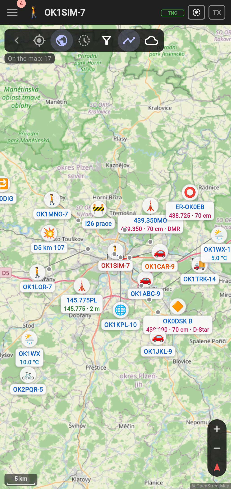
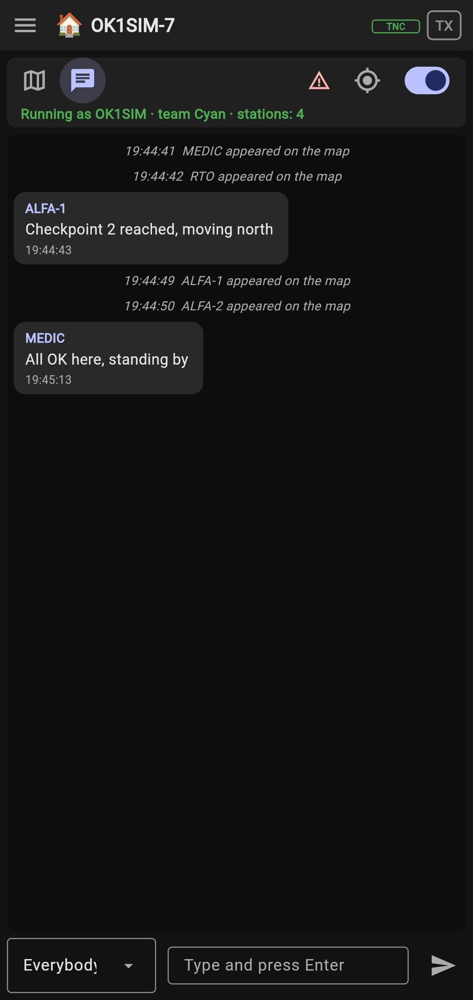
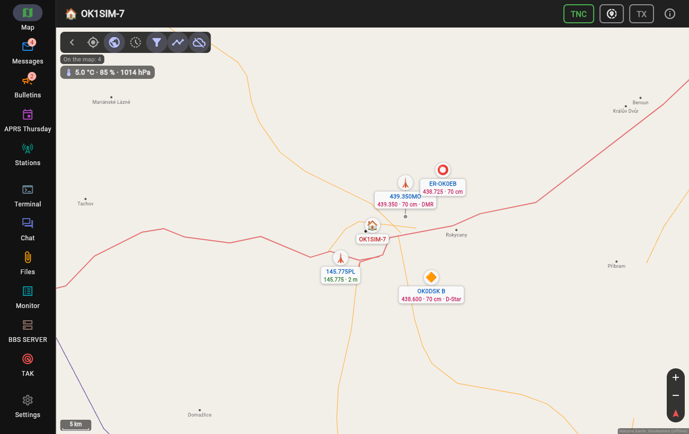
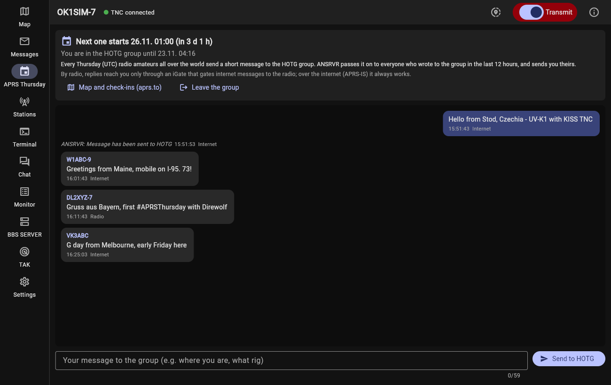
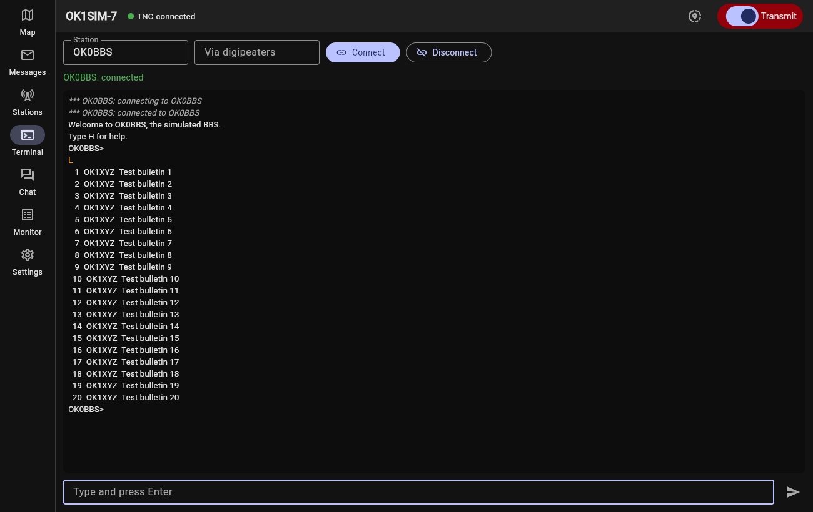
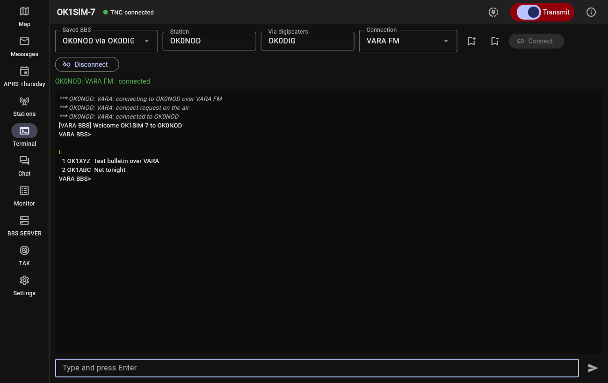
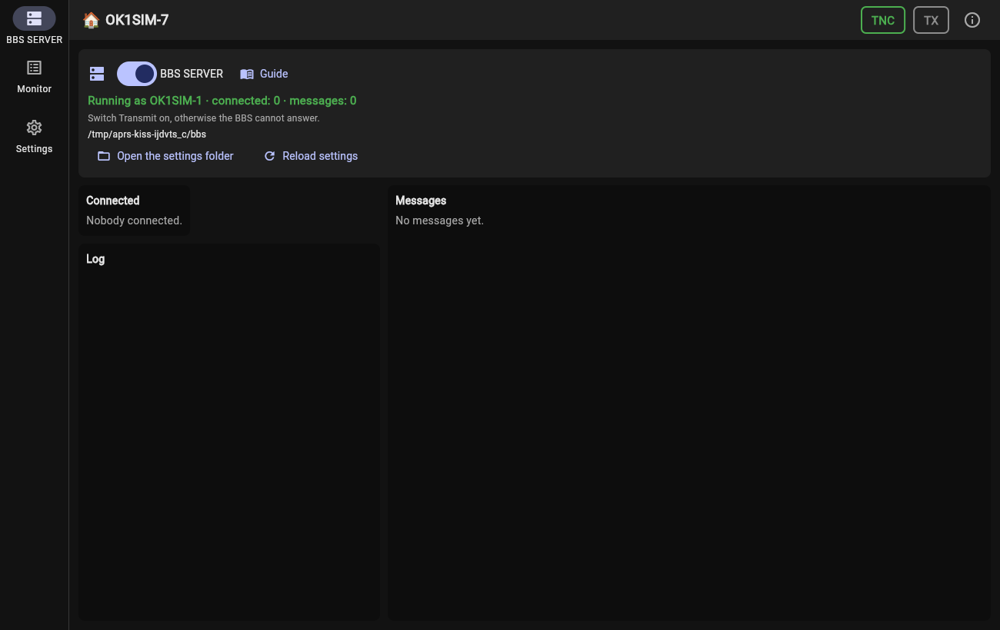
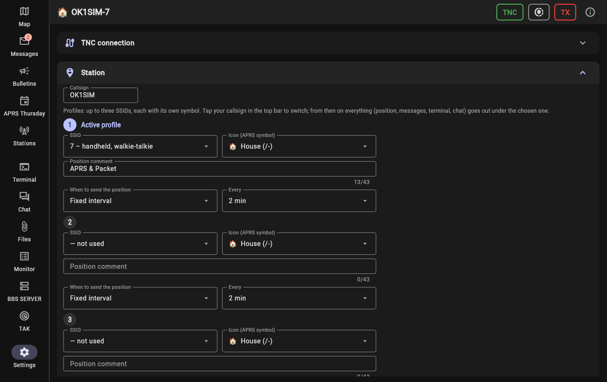

# APRS & Packet – standalone app

**English** · [Česky](README.cs.md)

An APRS station and packet radio terminal for a radio with a **KISS TNC**, as a normal application for
computers and **Android phones** – no Home Assistant, no web server. It is the standalone sibling of the
[APRS & Packet Home Assistant integration](https://github.com/michalsiman/aprs-kiss-ha) and shares
its radio core.

Made for the Quansheng UV-K1/UV-K5 V3 with the [F4HWN firmware](https://github.com/armel/uv-k1-k5v3-firmware-custom)
and its [KISS TNC app](https://github.com/armel/uv-k1-k5v3-firmware-custom/wiki/App-KISS-TNC), but any KISS TNC works
(Direwolf, a hardware TNC, the radio's USB serial port, or the KISS TCP bridge from the integration).
Verified also with the **VGC VR-N76** and **AnyTone UV890** handhelds.

**Status: actively developed** – new versions come out often (see [CHANGELOG](CHANGELOG.md)).
Ready for **Linux**, **Windows** and **Android**; **macOS** and **iOS** builds exist but nobody has tried
them on a real Mac, iPhone or iPad yet – **testers wanted** (see [Platforms](#platforms)).

## What it does

### APRS

- **Map** of heard stations (OpenStreetMap) with APRS symbols and framed callsign labels, your own
  position, tracked callsigns highlighted. Buttons to centre on you, a *Muted map* that fades the map
  so the stations stand out, stations from the internet on or off, *Last 2 hours* only, and a legend
  of the symbols – small icons that light up when on. Zoom buttons, a compass that turns the map north
  up again, a scale bar; two fingers turn the map only with a clear twist. Right-click (long press on a
  phone) the map: *Set as my position*. Only the stations around what is on screen are drawn, so the map
  stays quick also on a phone.
- **Offline map** bundled with the app: country borders, coastlines and about 1,000 bigger cities
  (Natural Earth); in Europe also motorways and main roads (Natural Earth), some 67,000 places of 1,000
  people and more and each country's 30 highest peaks (GeoNames) – more of them as you zoom in. One button switches to it; **with no internet the map
  switches to it by itself** and tells you so, and goes back to OpenStreetMap when the internet returns.
- **Tracker**: the position button in the top bar sends your position once, or starts the tracker (▶) –
  your GPS position then goes out by itself, at a fixed interval or **smart (SmartBeaconing)** like the APRS
  and LoRa APRS trackers: rarely when standing, more often the faster you go, at once on a turn; course and
  speed included. It sends by radio while TX is on (and over the internet when chosen).
- **Your own offline map** (Settings › Offline maps): import a better map, e.g. a topographic one, from
  wherever you get it – raster tile maps in **MBTiles, PMTiles, SQLiteDB** (OsmAnd, Locus), a **ZIP** of z/x/y
  tiles, or a ZIP/7z with such files inside (7z on a computer with 7-Zip). Several maps at once; the map
  button chooses between *online*, *imported* and *basic offline*. Vector maps (Mapsforge, vector MBTiles)
  are not supported.
- **Messages** as conversations: retried until acknowledged, delivery state shown, incoming messages
  acknowledged automatically; a new message to any callsign; a notice when one arrives.
- **#APRSThursday**: its own section for the weekly HOTG net through ANSRVR – check in with one
  button, read the group's messages apart from your inbox, see when the next net starts, leave the group.
- **Stations** heard on the radio or seen on APRS-IS: distance, direction, comment, weather, the path;
  a filter and a legend. Stations an iGate relays from the internet by radio (third-party packets)
  show up too.
- **Position beacon** every N minutes and a *Send position now* button in the top bar; status and
  unproto. Icon (APRS symbol), comment, SSID and path in Settings.
- **Digipeater**: fill-in (WIDE1-1, for a home station) or full (WIDEn-N with a hop limit), frames
  addressed to your callsign or aliases (e.g. RELAY), the same packet only once in 30 seconds.
- **APRS-IS** (internet) with an optional RX and TX **iGate**; messages an iGate relays to you by
  radio are received and acknowledged.
- **Your position from a GPS**: the phone's own GPS (the default on a phone with no position typed in;
  Settings shows where it says you are), or a **USB GPS module** (NMEA, u-blox/VK-172 and the like, speed found automatically): with a fix the map,
  the beacon (with altitude) and TAK use its position; the GPS state is shown in the top bar.

### Packet radio

- **Terminal**: AX.25 connected mode to BBSes and nodes, through digipeaters if you like; a list of
  **saved BBSes** to pick from; the connect attempts with their times and a *Stop connecting* button;
  optional incoming connections.
- **Terminal over VARA FM**: the same terminal over VARA FM instead of AX.25 – *Connection: VARA FM*.
  VARA runs on its own (Windows, or Wine on Linux) with the radio on a sound card such as an AIOC cable;
  the app talks to it over its TCP interface (ports 8300/8301) and shows its progress, PTT and the
  transmit buffer.
- **Chat**: plain text to CQ, QST, ALL or you, heard by everybody on the frequency; automatic frames
  such as digipeater DX reports stay out. See the **[chat specification](docs/CHAT.md)** to use it
  from other software.
- **Monitor**: every frame received and sent, TNC style, with pause and clear; it can hide the APRS-IS
  lines, and shows TAK frames decoded.
- **BBS SERVER**: run your own packet BBS on your callsign with its own SSID – classic W0RLI / MBL / FBB
  commands, personal messages and bulletins, limits for clients, idle time, airtime and stored messages;
  settings and texts in plain files (bbs.toml, welcome.txt, …), one text file per message. While it runs,
  everything else in the app is off (the radio sits on the BBS frequency, never on 144.800); switching
  it on takes a typed confirmation. See the **[BBS SERVER guide](docs/BBS.md)**.
- **TAK**: the app as a TAK station over the radio – ATAK-compatible positions and GeoChat (TAK Protocol v1
  in AX.25 UI frames), its own map with the stations coloured by team, a list of stations, messages to
  everybody or one station, your team, role and callsign in Settings; who appeared on the map and who
  moved how far is shown in GeoChat. On a phone the map and GeoChat are two screens, with the number of
  unread messages on the GeoChat icon. Its frames fit LoRa KISS modems too (MeshCore). Like BBS SERVER
  it switches everything else off. See the **[TAK specification](docs/TAK.md)**.

### The app

- **KISS over TCP** (Direwolf, a network bridge) or a **serial/USB port** (the list shows the ports,
  with stable `/dev/serial/by-id` names on Linux); TX delay for the TNC; reconnects by itself.
- In **16 languages**: Brazilian Portuguese, Croatian, Czech, Danish, English, French, German, Italian,
  Norwegian (Bokmål), Polish, Serbian (Cyrillic), Slovak, Slovenian, Spanish, Swedish and Ukrainian;
  it follows the system language or you pick one in Settings.
- **Light and dark** appearance, following the system or chosen in Settings.
- **Sounds**: a beep when the radio transmits, sounds for a new APRS message, chat line and TAK GeoChat
  message – each on or off in Settings.
- **Keep the screen on**: never, while TAK runs, or always.
- **Settings in folded blocks**; the callsign is required (framed red until it is saved). The
  confirmation sentences (TAK, BBS SERVER, the licence for APRS-IS) are typed once, not every time.
- **The first start** asks for the language (the device's is offered) and shows a warning that has to
  be accepted: transmitting needs an amateur radio licence.
- Tells you when a new version is out: asks GitHub at most once a day for the latest release,
  sends nothing about you; can be switched off in Settings. On Android *Download* fetches the new .apk.

### On a phone (Android)

- The screens are in a menu that slides in from the side (☰); the top bar is a dashboard: **TNC**, **IS**
  and **GPS** lamps green when working, **TX** with a red frame while transmitting is on and all red while
  a frame goes out on air – a tap on TX switches transmitting, a tap on TNC or GPS tells their state.
- **The TNC on the phone's USB port** (OTG cable): the Quansheng with the F4HWN KISS firmware and other
  CDC-ACM TNCs, CP210x and FTDI cables; **over Bluetooth** (a paired TNC or radio with the serial port
  profile, e.g. Mobilinkd TNC3 or a handheld with a Bluetooth KISS TNC); or over the network.
- **The phone's GPS** as your position.
- **Running in the background** (Settings › Background and screen): receiving, beacons, messages and TAK
  go on when the app is not on screen or the phone is locked, with a notification.

> **Transmitting is off by default.** Switch *Transmit* on in the top bar only if you hold an amateur
> radio licence. APRS-IS can be switched on only after typing the licence statement.

## Screenshots

Taken with the simulated TNC and VARA (`tests/fake_tnc.py --tak`, `tests/fake_vara.py`); click for
full size. They follow your GitHub theme, and so does the app: it uses the system's light or dark mode.

<table>
<tr>
<td colspan="2"><a href="assets/map.png"><picture><source media="(prefers-color-scheme: light)" srcset="assets/map-light.png"></picture></a><br><sub>Map of heard stations</sub></td>
</tr>
<tr>
<td colspan="2"><a href="assets/phone-map.png"><picture><source media="(prefers-color-scheme: light)" srcset="assets/phone-map-light.png"></picture></a> <a href="assets/phone-menu.png"><picture><source media="(prefers-color-scheme: light)" srcset="assets/phone-menu-light.png"></picture></a> <a href="assets/phone-tak.png"><picture><source media="(prefers-color-scheme: light)" srcset="assets/phone-tak-light.png"></picture></a> <a href="assets/phone-tak-chat.png"><picture><source media="(prefers-color-scheme: light)" srcset="assets/phone-tak-chat-light.png"></picture></a> <a href="assets/phone-settings.png"><picture><source media="(prefers-color-scheme: light)" srcset="assets/phone-settings-light.png"></picture></a><br><sub>On a phone: the map, the menu, TAK map and GeoChat, Settings</sub></td>
</tr>
<tr>
<td width="50%"><a href="assets/map-offline.png"><picture><source media="(prefers-color-scheme: light)" srcset="assets/map-offline-light.png"></picture></a><br><sub>Offline map (no internet needed)</sub></td>
<td width="50%"><a href="assets/messages.png"><picture><source media="(prefers-color-scheme: light)" srcset="assets/messages-light.png"></picture></a><br><sub>Messages, the sent one acknowledged</sub></td>
</tr>
<tr>
<td width="50%"><a href="assets/thursday.png"><picture><source media="(prefers-color-scheme: light)" srcset="assets/thursday-light.png"></picture></a><br><sub>#APRSThursday</sub></td>
<td width="50%"><a href="assets/stations.png"><picture><source media="(prefers-color-scheme: light)" srcset="assets/stations-light.png"></picture></a><br><sub>Stations with distance and direction</sub></td>
</tr>
<tr>
<td width="50%"><a href="assets/terminal.png"><picture><source media="(prefers-color-scheme: light)" srcset="assets/terminal-light.png"></picture></a><br><sub>Terminal over AX.25 packet</sub></td>
<td width="50%"><a href="assets/terminal-vara.png"><picture><source media="(prefers-color-scheme: light)" srcset="assets/terminal-vara-light.png"></picture></a><br><sub>Terminal over VARA FM</sub></td>
</tr>
<tr>
<td width="50%"><a href="assets/chat.png"><picture><source media="(prefers-color-scheme: light)" srcset="assets/chat-light.png"></picture></a><br><sub>Packet chat</sub></td>
<td width="50%"><a href="assets/monitor.png"><picture><source media="(prefers-color-scheme: light)" srcset="assets/monitor-light.png"></picture></a><br><sub>Frame monitor</sub></td>
</tr>
<tr>
<td colspan="2"><a href="assets/tak.png"><picture><source media="(prefers-color-scheme: light)" srcset="assets/tak-light.png"></picture></a><br><sub>TAK: stations by team and GeoChat</sub></td>
</tr>
<tr>
<td width="50%"><a href="assets/bbs.png"><picture><source media="(prefers-color-scheme: light)" srcset="assets/bbs-light.png"></picture></a><br><sub>BBS SERVER</sub></td>
<td width="50%"><a href="assets/bbs-confirm.png"><picture><source media="(prefers-color-scheme: light)" srcset="assets/bbs-confirm-light.png"></picture></a><br><sub>BBS SERVER is switched on with a typed sentence</sub></td>
</tr>
<tr>
<td width="50%"><a href="assets/settings.png"><picture><source media="(prefers-color-scheme: light)" srcset="assets/settings-light.png"></picture></a><br><sub>Settings: TNC and station</sub></td>
<td width="50%"><a href="assets/settings-more.png"><picture><source media="(prefers-color-scheme: light)" srcset="assets/settings-more-light.png"></picture></a><br><sub>Settings: background and screen, sounds</sub></td>
</tr>
</table>

## Install (Windows)

Download **`aprs-kiss-…-windows-x64-setup.exe`** from the
[latest release](https://github.com/michalsiman/aprs-kiss-app/releases/latest) and run it, or take the
**`…-windows-x64.zip`** and unpack it anywhere. The radio on USB shows up as a COM port in Settings.

## Install (macOS)

Download **`aprs-kiss-…-macos.dmg`** from the
[latest release](https://github.com/michalsiman/aprs-kiss-app/releases/latest), open it and drag
*APRS & Packet* to Applications. The app is not signed by Apple (no paid developer account), so the
first time **right-click it › Open › Open**, or allow it in *System Settings › Privacy & Security ›
Open Anyway*. The radio on USB shows up as `/dev/cu.usbserial…` / `/dev/cu.usbmodem…` in Settings.
The macOS build is made on GitHub without a Mac to try it on – **testers wanted**: tell us in the
[issues](https://github.com/michalsiman/aprs-kiss-app/issues) how it went.

## Install (Android)

Download **`aprs-kiss-…-android.apk`** on the phone from the
[latest release](https://github.com/michalsiman/aprs-kiss-app/releases/latest) and open it; Android asks
to allow installing apps from the browser or file manager once. On the phone the app reaches the TNC
**on the phone's USB port** (Settings › Connection: TNC on USB, through an OTG cable or adapter; the
Quansheng with the F4HWN KISS firmware and other CDC-ACM TNCs, CP210x and FTDI cables; Android asks once
to allow the app to use it) or **over the network (KISS over TCP)**: Direwolf on a computer, the radio
shared with [`kiss_tcp_bridge.py`](https://github.com/michalsiman/aprs-kiss-ha/tree/main/bridge), or a
Wi-Fi TNC. The screens fit a phone and are switched in a menu that slides in from the side (☰). Your position can come
from **the phone's GPS** (Settings › GPS). BBS SERVER and USB GPS modules are for computers only.
The .apk is signed with the project's own key, so a new version installs over the previous one (from
0.1.30 on; an older one has to be uninstalled once); the app tells you when one is out and downloads it.
A Google Play release is being prepared.

## Install (iPhone, iPad)

Apple lets apps onto an iPhone only through the App Store or signed by a developer account, which this
project does not have. The release has an **unsigned `aprs-kiss-…-ios-unsigned.ipa`** that you can put on
your device with a sideloading tool such as [AltStore](https://altstore.io/) or
[Sideloadly](https://sideloadly.io/), which signs it with your own Apple ID (with a free Apple ID it has
to be refreshed every 7 days). Like on Android, the TNC is reached over the network.
**Not tried on a real iPhone or iPad yet – testers wanted:** if you can try it, please tell us how it went
in the [issues](https://github.com/michalsiman/aprs-kiss-app/issues).

## Install (Linux)

**With automatic updates (Flatpak):** open
**[michalsiman.github.io/aprs-kiss-app](https://michalsiman.github.io/aprs-kiss-app/)** and click
*Install*, or run

```bash
flatpak install https://michalsiman.github.io/aprs-kiss-app/aprs-kiss.flatpakref
```

(Without `--user`: Linux Mint's Update Manager and Software Manager only see the system-wide
installation, so that is where the updates show up.) It works on any distribution with Flatpak (Linux Mint, Fedora, Ubuntu with Flatpak, …). New versions
then come with your other updates, from our own signed Flatpak repository
(key fingerprint `0E31 685C C5D6 4B8C 7837  B62F 66ED ABD8 50DC 14BD`).

**Or download a package** from the [latest release](https://github.com/michalsiman/aprs-kiss-app/releases/latest)
and double-click it:

- **`aprs-kiss-…-x86_64.flatpak`**: the same Flatpak as a single file; it also updates from the
  repository above (releases from 0.1.5 on).
- **`aprs-kiss_…_amd64.deb`**: Debian, Ubuntu, Linux Mint (22.04 / Debian 12 and newer).
- **`aprs-kiss-…-linux-x86_64.tar.gz`**: unpack anywhere and run `./aprs-kiss`.

None of them needs Python. For a TNC on a USB serial port your user needs to be in the `dialout`
group: `sudo usermod -aG dialout $USER`, then log in again.

### With Python

Python 3.10 or newer.

```bash
pipx install "aprs-kiss[desktop] @ git+https://github.com/michalsiman/aprs-kiss-app"
aprs-kiss
```

Or from a checkout:

```bash
git clone https://github.com/michalsiman/aprs-kiss-app && cd aprs-kiss-app
python3 -m venv .venv && .venv/bin/pip install -e ".[dev]"
.venv/bin/flet run src/main.py      # or: .venv/bin/aprs-kiss
```

The first start opens **Settings**: set your callsign, your position and how to reach the TNC:

- **KISS over TCP** – Direwolf (port 8001), or the radio shared on the network with
  [`kiss_tcp_bridge.py`](https://github.com/michalsiman/aprs-kiss-ha/tree/main/bridge)
- **Serial port** – the radio plugged into this computer; pick it from the list
  (`/dev/serial/by-id/...` names stay the same after replugging). Your user needs to be in the
  `dialout` group: `sudo usermod -aG dialout $USER`, then log in again.

Settings and message history live in `~/.local/share/aprs-kiss/` (`APRS_KISS_DATA` overrides it).

### Trying it without a radio

```bash
.venv/bin/python tests/fake_tnc.py --port 8001 --mycall OK1SIM-7
```

A simulated TNC: stations, a weather report and messages arrive every few seconds, it acknowledges
your messages, answers chat and runs a small BBS (`OK0BBS`: H, L, B). Point the app at
`127.0.0.1:8001`. With `--tak` it also sends TAK stations and GeoChat for TAK mode.

```bash
.venv/bin/python tests/fake_vara.py --port 8300
```

A pretend VARA FM for the terminal: set Settings › VARA FM to `127.0.0.1`, port 8300, and connect
with *Connection: VARA FM* to any callsign (a small BBS answers: L, B; `NOANSWER` never answers).

### Packages

The *Release packages* workflow runs `flet build linux` once and makes the tarball, the `.deb`
(`packaging/deb/build-deb.sh`) and the Flatpak (`packaging/flatpak/`) from it, attached to each
`v*` release. The desktop entry, AppStream metainfo and icons are in `packaging/linux/`.

## How it is built

```
src/
  aprs_kiss_core/   the radio, no user interface: KISS, AX.25 (UI + connected mode), APRS,
                    APRS-IS/iGate, the station (acks, retries, limits), the BBS server (bbs/),
                    TAK (tak.py), USB GPS (gps.py), VARA FM (vara.py), APRS Thursday (thursday.py)
                    and the Engine that ties it together and announces events to listeners
  aprs_kiss_app/    the Flet user interface: one view per screen; the offline map data (offline/)
  main.py           entry point for `flet run` / `flet build`
tests/              unit tests, engine tests against fake_tnc.py and fake_vara.py
```

- **Flet** (Python, drawn by Flutter): one code base for desktop and mobile, a native window,
  no web server.
- **Transports are pluggable** (`aprs_kiss_core.connection.register_transport`): TCP and
  serial are built in; Android USB host and Bluetooth TNCs can be added as their own transports
  without touching the KISS/AX.25 code.
- The core modules are the same as in the Home Assistant integration (`hub.py` there,
  `engine.py` here). The plan is to publish the core as one package both use.

Privacy: the app collects nothing; see the [privacy policy](https://michalsiman.github.io/aprs-kiss-app/privacy.html).

## Platforms

Linux, Windows and Android are used every day; macOS and iOS are built but untested (testers wanted).

| | Linux | Windows | macOS (untested) | Android | iOS (untested) |
|---|---|---|---|---|---|
| KISS over TCP | ✅ | ✅ | ✅ | ✅ | ✅ (sideloaded) |
| USB serial | ✅ | ✅ (COM ports) | ✅ | ✅ (OTG: CDC-ACM, CP210x, FTDI) | ❌ (iOS) |
| Bluetooth TNC (SPP) | ✅ (as a serial port: rfcomm) | ✅ (as a COM port) | – | ✅ (paired, in Settings) | ❌ (BLE only) |
| USB GPS module | ✅ | ✅ (COM ports) | ✅ | – | ❌ |
| Phone's own GPS | – | – | – | ✅ | ✅ |
| VARA FM | ✅ (VARA in Wine) | ✅ | VARA on another computer | VARA on another computer | VARA on another computer |
| BBS SERVER | ✅ | ✅ | ✅ | – (computers only) | – (computers only) |
| Running in the background | ✅ | ✅ | ✅ | ✅ (Settings, with a notification) | limited by iOS |
| Keep the screen on, sounds | ✅ | ✅ | ✅ | ✅ | ✅ |

## Tests

```bash
.venv/bin/python -m unittest discover -s tests -t .
```

## Credits and licence

- Written by [Michal Šiman](https://github.com/michalsiman) ([OK1SIM](https://ok1sim.cz/)) together with
  [Claude Code](https://claude.com/claude-code).
- User interface by [Flet](https://flet.dev) (Flutter), maps by [flutter_map](https://github.com/fleaflet/flutter_map)
  through flet-map, map data © OpenStreetMap contributors.
- Offline map from [Natural Earth](https://www.naturalearthdata.com/) (public domain) and
  [GeoNames](https://www.geonames.org/) (CC BY 4.0).
- APRS parsing by [aprslib](https://github.com/rossengeorgiev/aprs-python).
- [F4HWN firmware](https://github.com/armel/uv-k1-k5v3-firmware-custom) for the Quansheng UV-K1/K5 V3 by **Armel F4HWN**,
  its [KISS TNC app](https://github.com/armel/uv-k1-k5v3-firmware-custom/wiki/App-KISS-TNC) by **F4WAT**.

MIT licence, see [LICENSE](LICENSE).
