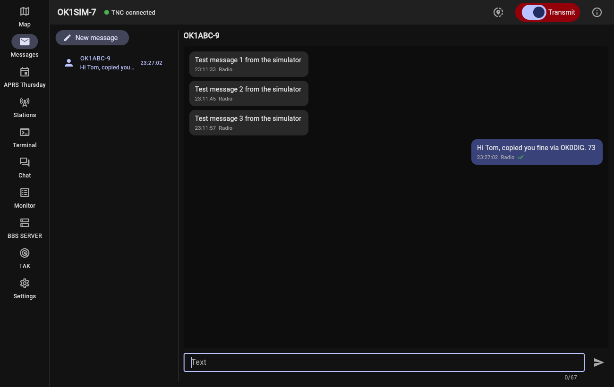
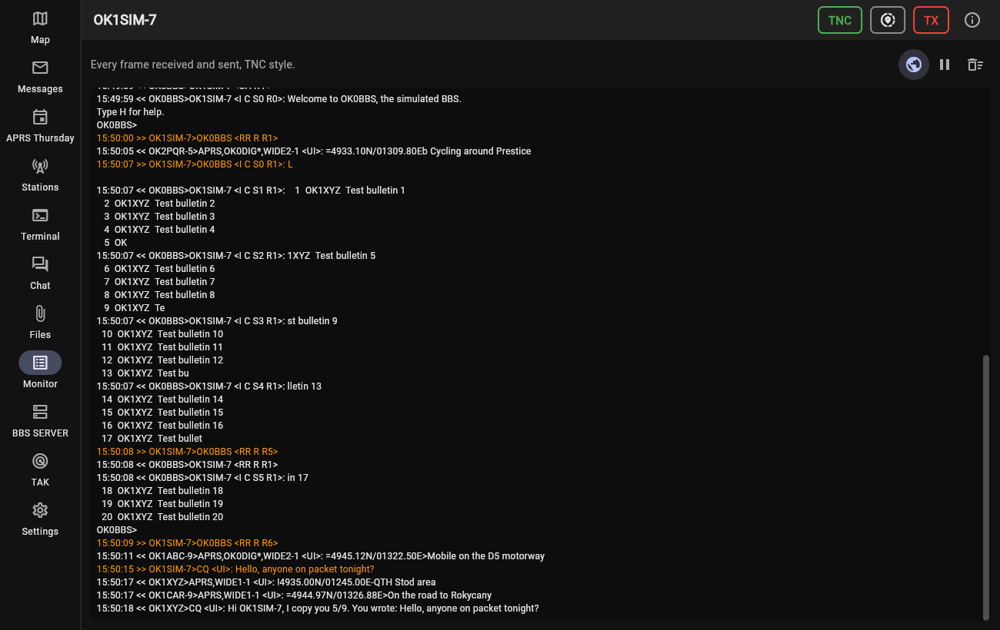

# APRS & Packet – standalone app

An APRS station and packet radio terminal for a radio with a **KISS TNC**, as a normal desktop
application – no Home Assistant, no web server. It is the standalone sibling of the
[APRS & Packet Home Assistant integration](https://github.com/michalsiman/aprs-kiss-ha) and shares
its radio core.

Made for the Quansheng UV-K1/UV-K5 V3 with the [F4HWN firmware](https://github.com/armel/uv-k1-k5v3-firmware-custom)
and its [KISS TNC app](https://github.com/armel/uv-k1-k5v3-firmware-custom/wiki/App-KISS-TNC), but any KISS TNC works
(Direwolf, a hardware TNC, the radio's USB serial port, or the KISS TCP bridge from the integration).

**Status: 0.1.0, Linux first.** The same code is meant to be built for Windows, macOS, Android
and iOS later (see [Platforms](#platforms)).

## What it does

- **Map** of heard stations (OpenStreetMap), your own position, tracked callsigns highlighted
- **APRS messages** as conversations, retried until acknowledged, delivery state shown;
  incoming messages acknowledged automatically
- **Stations** heard on the radio or seen on APRS-IS: distance, direction, comment, weather
- **Packet terminal**: AX.25 connected mode to BBSes and nodes, optional incoming connections
- **Packet chat** (plain text to CQ) and a TNC-style **frame monitor**
- **APRS-IS** (internet) with optional RX and TX iGate
- Position beacon, status, unproto
- English and Czech
- Tells you when a new version is out: asks GitHub at most once a day for the latest release,
  sends nothing about you; can be switched off in Settings

> **Transmitting is off by default.** Switch *Transmit* on in the top bar only if you hold an amateur
> radio licence. APRS-IS can be switched on only after typing the licence statement.

## Screenshots

Taken with the simulated TNC (`tests/fake_tnc.py`); click for full size. They follow your
GitHub theme, and so does the app: it uses the system's light or dark mode.

<table>
<tr>
<td colspan="2"><a href="assets/map.png"><picture><source media="(prefers-color-scheme: light)" srcset="assets/map-light.png"></picture></a></td>
</tr>
<tr>
<td width="50%"><a href="assets/messages.png"><picture><source media="(prefers-color-scheme: light)" srcset="assets/messages-light.png"></picture></a></td>
<td width="50%"><a href="assets/stations.png"><picture><source media="(prefers-color-scheme: light)" srcset="assets/stations-light.png"></picture></a></td>
</tr>
<tr>
<td><a href="assets/terminal.png"><picture><source media="(prefers-color-scheme: light)" srcset="assets/terminal-light.png"></picture></a></td>
<td><a href="assets/chat.png"><picture><source media="(prefers-color-scheme: light)" srcset="assets/chat-light.png"></picture></a></td>
</tr>
<tr>
<td><a href="assets/monitor.png"><picture><source media="(prefers-color-scheme: light)" srcset="assets/monitor-light.png"></picture></a></td>
<td><a href="assets/settings.png"><picture><source media="(prefers-color-scheme: light)" srcset="assets/settings-light.png"></picture></a></td>
</tr>
</table>

## Install (Linux)

Download from the [latest release](https://github.com/michalsiman/aprs-kiss-app/releases/latest)
and double-click it; your software centre installs it with one click:

- **`aprs-kiss-…-x86_64.flatpak`**: any distribution with Flatpak (Linux Mint, Fedora, Ubuntu with
  Flatpak, …). A Flathub listing, with automatic updates, is on the way.
- **`aprs-kiss_…_amd64.deb`**: Debian, Ubuntu, Linux Mint (22.04 / Debian 12 and newer).
- **`aprs-kiss-…-linux-x86_64.tar.gz`**: unpack anywhere and run `./aprs-kiss`.

None of them needs Python. For a TNC on a USB serial port your user needs to be in the `dialout`
group: `sudo usermod -aG dialout $USER`, then log in again.

### With Python

Python 3.10 or newer.

```bash
pipx install "aprs-kiss[desktop] @ git+https://github.com/michalsiman/aprs-kiss-app"
aprs-kiss
```

Or from a checkout:

```bash
git clone https://github.com/michalsiman/aprs-kiss-app && cd aprs-kiss-app
python3 -m venv .venv && .venv/bin/pip install -e ".[dev]"
.venv/bin/flet run src/main.py      # or: .venv/bin/aprs-kiss
```

The first start opens **Settings**: set your callsign, your position and how to reach the TNC:

- **KISS over TCP** – Direwolf (port 8001), or the radio shared on the network with
  [`kiss_tcp_bridge.py`](https://github.com/michalsiman/aprs-kiss-ha/tree/main/bridge)
- **Serial port** – the radio plugged into this computer; pick it from the list
  (`/dev/serial/by-id/...` names stay the same after replugging). Your user needs to be in the
  `dialout` group: `sudo usermod -aG dialout $USER`, then log in again.

Settings and message history live in `~/.local/share/aprs-kiss/` (`APRS_KISS_DATA` overrides it).

### Trying it without a radio

```bash
.venv/bin/python tests/fake_tnc.py --port 8001 --mycall OK1SIM-7
```

A simulated TNC: stations, a weather report and messages arrive every few seconds, it acknowledges
your messages, answers chat and runs a small BBS (`OK0BBS`: H, L, B). Point the app at
`127.0.0.1:8001`.

### Packages

The *Release packages* workflow runs `flet build linux` once and makes the tarball, the `.deb`
(`packaging/deb/build-deb.sh`) and the Flatpak (`packaging/flatpak/`) from it, attached to each
`v*` release. The desktop entry, AppStream metainfo and icons are in `packaging/linux/`.

## How it is built

```
src/
  aprs_kiss_core/   the radio, no user interface: KISS, AX.25 (UI + connected mode), APRS,
                    APRS-IS/iGate, the station (acks, retries, limits) and the Engine that
                    ties it together and announces events to listeners
  aprs_kiss_app/    the Flet user interface: one view per screen
  main.py           entry point for `flet run` / `flet build`
tests/              unit tests, engine tests against fake_tnc.py
```

- **Flet** (Python, drawn by Flutter): one code base for desktop and mobile, a native window,
  no web server.
- **Transports are pluggable** (`aprs_kiss_core.connection.register_transport`): TCP and
  serial are built in; Android USB host and Bluetooth TNCs will be added as their own transports
  without touching the KISS/AX.25 code.
- The core modules are the same as in the Home Assistant integration (`hub.py` there,
  `engine.py` here). The plan is to publish the core as one package both use.

## Platforms

| | Linux | Windows | macOS | Android | iOS |
|---|---|---|---|---|---|
| KISS over TCP | ✅ | planned | planned | planned | planned |
| USB serial | ✅ | planned (COM ports) | planned | needs a USB-host transport | ❌ (iOS) |
| Bluetooth TNC | – | – | – | planned | BLE only |
| Running in the background | ✅ | ✅ | ✅ | needs a foreground service | limited by iOS |

## Tests

```bash
.venv/bin/python -m unittest discover -s tests -t .
```

## Credits and licence

- Written by [Michal Šiman](https://github.com/michalsiman) ([OK1SIM](https://ok1sim.cz/)) together with
  [Claude Code](https://claude.com/claude-code).
- User interface by [Flet](https://flet.dev) (Flutter), maps by [flutter_map](https://github.com/fleaflet/flutter_map)
  through flet-map, map data © OpenStreetMap contributors.
- APRS parsing by [aprslib](https://github.com/rossengeorgiev/aprs-python).
- [F4HWN firmware](https://github.com/armel/uv-k1-k5v3-firmware-custom) for the Quansheng UV-K1/K5 V3 by **Armel F4HWN**,
  its [KISS TNC app](https://github.com/armel/uv-k1-k5v3-firmware-custom/wiki/App-KISS-TNC) by **F4WAT**.

MIT licence, see [LICENSE](LICENSE).
