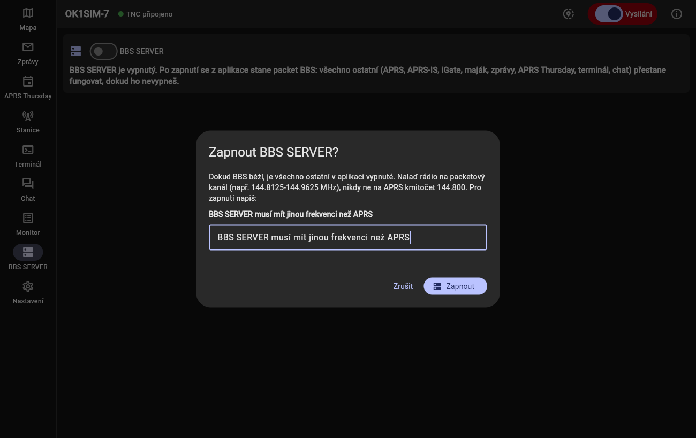
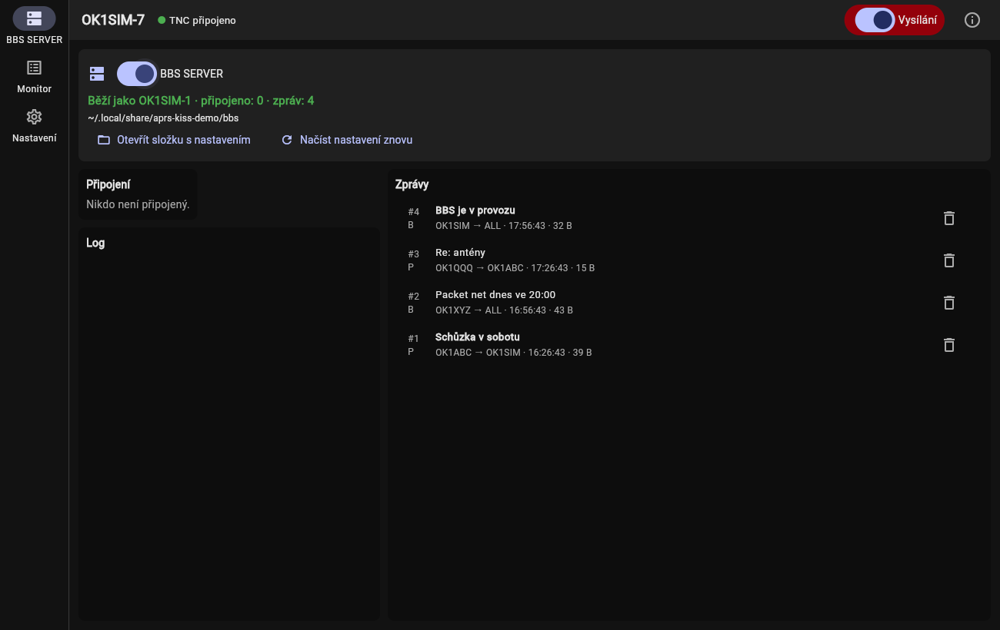
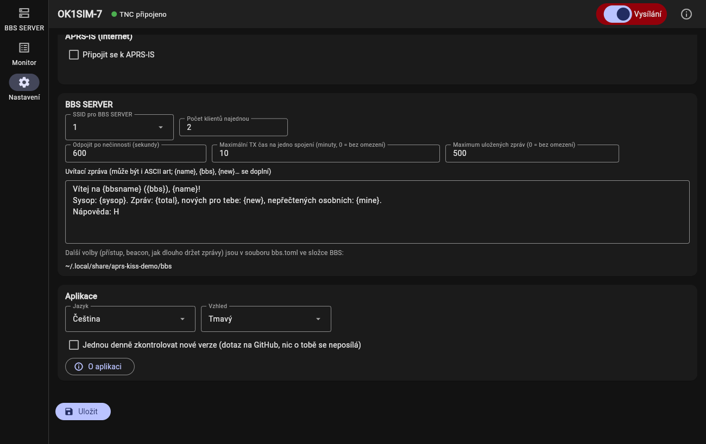

# BBS SERVER – návod

[English](BBS.md) · **Česky**

Aplikace APRS & Packet umí provozovat vlastní packet radio BBS: ostatní stanice se k ní připojí
přes AX.25 a čtou a píšou zprávy klasickými příkazy W0RLI / MBL / FBB. Tento návod popisuje
zapnutí, nastavení a soubory, které BBS používá.

## Než ji zapnete

- **Dokud BBS SERVER běží, je aplikace jen BBS.** APRS, APRS-IS, iGate, maják, zprávy,
  APRS Thursday, terminál i chat jsou vypnuté, dokud ji zase nevypnete. Zůstává jen **Monitor**,
  abyste viděli, co rádio slyší.
- **Nalaďte rádio na packetový kanál, nikdy ne na APRS kmitočet 144.800 MHz.** Podle kmitočtového
  plánu IARU Region 1 (i českého) je pro packet úsek 144.8125–144.9625 MHz po 12,5 kHz.
  Rádio se zatím nedá přeladit přes USB, kmitočet tedy nastavte přímo na rádiu.
- **Zapněte Vysílání** v horní liště, jinak BBS nemůže odpovídat.
- Bezobslužná stanice má svá pravidla; ověřte si podmínky svého oprávnění.

## Zapnutí

1. **Nastavení › BBS SERVER**: vyberte **SSID**, na kterém BBS odpovídá (vaše značka s tímto SSID,
   např. `OK1SIM-1`; musí být jiné než SSID vaší stanice) a stiskněte **Uložit**.
2. Otevřete sekci **BBS SERVER** a zapněte přepínač.
3. Napište větu **BBS SERVER musí mít jinou frekvenci než APRS** (na velikosti písmen a diakritice
   nezáleží, projde i anglická věta) a stiskněte **Zapnout**.

<picture><source media="(prefers-color-scheme: light)" srcset="../assets/cs/bbs-confirm-light.png"></picture>

Sekce pak ukazuje, kdo je připojený, zprávy (kliknutím zprávu otevřete, koš ji smaže) a log.
Vypnutím přepínače se vrátí celá aplikace.

<picture><source media="(prefers-color-scheme: light)" srcset="../assets/cs/bbs-light.png"></picture>

## Nastavení v aplikaci

**Nastavení › BBS SERVER** zapisuje rovnou do souborů BBS a zachová v nich komentáře:

| Pole | V souboru | Význam |
|---|---|---|
| SSID pro BBS SERVER | nastavení aplikace | značka BBS je vaše značka s tímto SSID |
| Počet klientů najednou | `max_sessions` | kolik spojení najednou; rádio je jedno, takže málo |
| Odpojit po nečinnosti (sekundy) | `idle_timeout_sec` | kdo tak dlouho nic nepošle, toho BBS odpojí |
| Maximální TX čas na jedno spojení | `max_tx_min` | kolik minut smí BBS vysílat jednomu spojení (odhad při 1200 Bd); pak se rozloučí. 0 = bez omezení |
| Maximum uložených zpráv | `max_messages` | nad tento počet BBS nové zprávy odmítne. 0 = bez omezení |
| Uvítací zpráva | `welcome.txt` | zobrazí se po připojení; může být i ASCII art |

Všechno ostatní se nastavuje v `bbs.toml`.

<picture><source media="(prefers-color-scheme: light)" srcset="../assets/cs/bbs-settings-light.png"></picture>

## Kde soubory najdete

V sekci BBS SERVER je tlačítko **Otevřít složku s nastavením** a cesta je napsaná pod ním
i dole v Nastavení › BBS SERVER. Obvykle:

- Linux, Flatpak: `~/.var/app/io.github.michalsiman.aprs_kiss_app/data/io.github.michalsiman.aprs_kiss_app/data/bbs/`
- Linux, .deb / archiv / Python: `~/.local/share/aprs-kiss/bbs/`
- Windows: `%LOCALAPPDATA%\aprs-kiss\bbs\`

Složka a soubory se vytvoří při prvním spuštění aplikace (česky, když aplikace běží česky, jinak
anglicky). Soubory, které jste upravili, se nikdy nepřepíšou.

| Soubor | Co to je |
|---|---|
| `bbs.toml` | hlavní nastavení, u každé volby komentář |
| `welcome.txt` | uvítání po připojení |
| `help.txt` | text příkazu `H` |
| `info.txt` | text příkazu `I` |
| `users.toml` | uživatelé; BBS si ho vede sama |
| `messages/000001.txt` … | zprávy, každá v jednom textovém souboru |
| `log.txt` | kdo se kdy připojil, co napsal a smazal |

## bbs.toml

```toml
[bbs]
name = "APRS & Packet BBS"   # název BBS ({bbsname} v textech)
address = ""                 # hierarchická adresa, např. "OK1SIM-1.#PLZ.CZE.EU"; prázdné = značka BBS
sysop = ""                   # značka sysopa bez SSID; prázdné = vaše značka

[limits]
max_sessions = 2             # spojení najednou
idle_timeout_sec = 600       # odpojit po tolika sekundách ticha
max_tx_min = 10              # vysílací čas na jedno spojení v minutách (0 = bez omezení)
max_messages = 500           # nad tento počet odmítnout nové zprávy (0 = bez omezení)
max_message_lines = 200      # nejdelší zpráva v řádcích
keep_personal_days = 60      # osobní zprávy smazat po N dnech (0 = nikdy)
keep_bulletins_days = 30     # bulletiny smazat po N dnech (0 = nikdy)

[access]
mode = "all"                 # "all" = kdokoliv, "list" = jen značky z users.toml (a sysop)
deny = ["N0CALL"]            # značky, které se nesmí připojit (bez SSID)
ask_name = true              # nového uživatele vyzvat, ať zadá jméno

[beacon]
every_min = 0                # UI rámec na MAIL každých N minut (0 = vypnuto)
text = "{bbs} {bbsname} - {total} msgs. Mail for: {mailfor}"
```

Po úpravě souboru stiskněte v sekci BBS SERVER **Načíst nastavení znovu**; připojení uživatelé
zůstanou připojení. Když je v souboru chyba, aplikace ukáže kde a ponechá předchozí nastavení.

## Zástupné znaky v textech

`welcome.txt`, `help.txt` a `info.txt` mohou obsahovat:

| Zástupný znak | Doplní se |
|---|---|
| `{call}` | značka uživatele |
| `{name}` | jméno uživatele (než si ho nastaví příkazem `N`, jeho značka) |
| `{bbs}` | značka BBS |
| `{bbsname}` | název BBS |
| `{sysop}` | značka sysopa |
| `{new}` | počet nových zpráv pro uživatele |
| `{mine}` | jeho nepřečtené osobní zprávy |
| `{total}` | všechny zprávy |

Text majáku zná navíc `{mailfor}`: značky, které mají nepřečtenou osobní poštu. Překlep
v zástupném znaku nic nerozbije, text se pak pošle tak, jak je.

## users.toml

```toml
[users."OK1ABC"]
name = "Tom"
qth = "Plzen"
home = "OK0XYZ"
sysop = false
first = 1795400000
last = 1795412345
last_listed = 12
connections = 7
```

Uživatelé se vedou bez SSID: `OK1ABC-7` a `OK1ABC` jsou stejný uživatel. `sysop = true` dává práva
sysopa (číst a mazat všechny zprávy). S `mode = "list"` se mohou připojit jen uživatelé z tohoto
souboru. Upravujte ho při vypnuté BBS; BBS ho zapisuje při každém připojení nebo změně jména.

## Zprávy

Každá zpráva je jeden soubor ve složce `messages/`: hlavička, prázdný řádek a text:

```
Number: 12
Type: P
From: OK1ABC
To: OK1SIM
At: OK1SIM-1
Date: 2026-11-22T15:00:00Z
Subject: Ahoj
Read-By: OK1SIM

Text zprávy...
```

`Type` je `P` (osobní), `B` (bulletin pro všechny) nebo `T` (traffic). Osobní zprávy vidí jen
odesílatel, příjemce a sysop. Čísla smazaných zpráv se znovu nepoužijí. Soubory se dají zálohovat
nebo číst v libovolném textovém editoru. Zprávy zůstávají na této BBS: předávání na jiné BBS
(forwarding) zatím není.

## Příkazy pro uživatele

| Příkaz | Co dělá |
|---|---|
| `L` | nové zprávy |
| `LM` / `LB` | moje zprávy / bulletiny |
| `LL n` | posledních n zpráv |
| `L< značka` / `L> značka` | zprávy od / pro značku |
| `R n` | přečíst zprávu n (i více čísel) |
| `RM` | přečíst moje nepřečtené |
| `S značka` / `SP značka @ BBS` | poslat osobní zprávu |
| `SB ALL` | poslat bulletin |
| `K n` / `KM` | smazat zprávu / smazat moje přečtené |
| `N jméno`, `NQ qth`, `NH bbs` | nastavit jméno, QTH, domovskou BBS |
| `I`, `H`, `J`, `V` | o BBS, nápověda, poslední připojení, verze |
| `B` nebo `Q` | konec |

Při posílání se BBS zeptá na předmět a pak na text; ukončíte ho `/EX` nebo Ctrl-Z na samostatném
řádku, `/ABORT` zprávu zruší.
