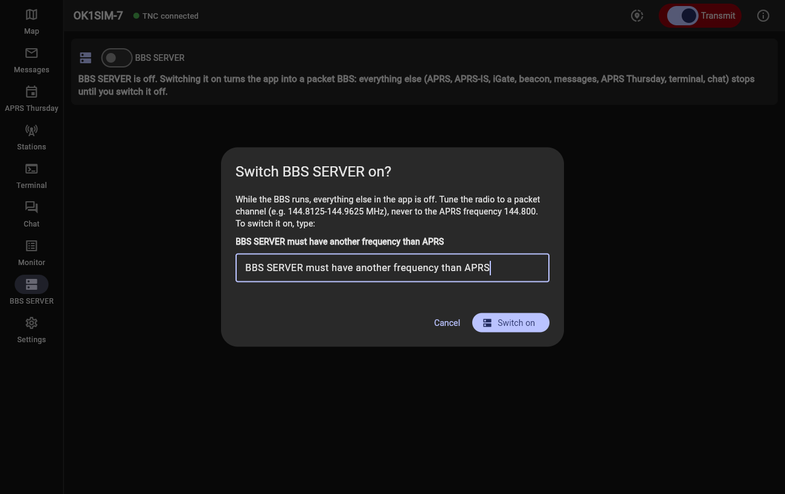
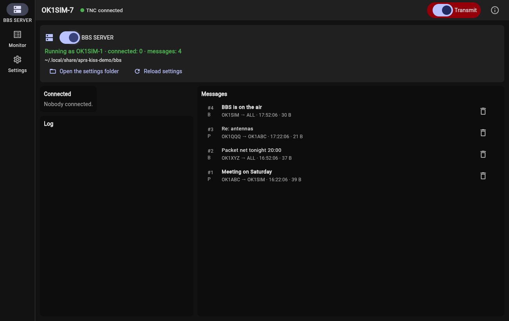
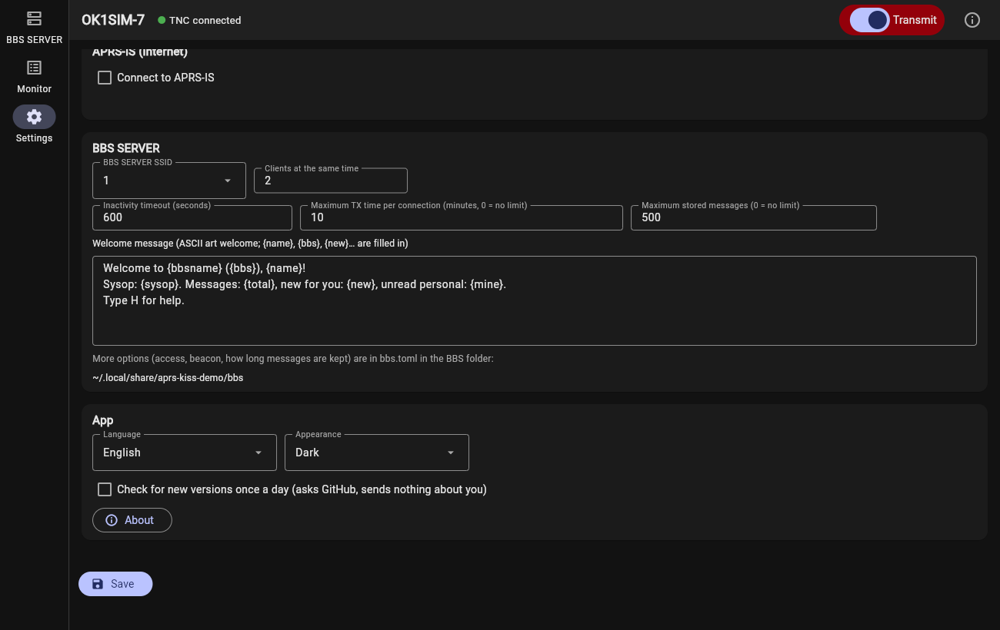

# BBS SERVER – guide

**English** · [Česky](BBS.cs.md)

APRS & Packet can run its own packet radio BBS: other stations connect to it over AX.25 and
read and write messages with the classic W0RLI / MBL / FBB commands. This guide covers switching
it on, the settings and the files it keeps.

## Before you switch it on

- **While BBS SERVER runs, the app is only the BBS.** APRS, APRS-IS, iGate, beacon, messages,
  APRS Thursday, terminal and chat are all off until you switch it off again. The **Monitor**
  stays, so you can see what the radio hears.
- **Tune the radio to a packet channel, never to the APRS frequency 144.800 MHz.** In IARU
  Region 1 (and in the Czech band plan) packet uses 144.8125–144.9625 MHz in 12.5 kHz steps.
  The radio cannot be retuned over USB yet, so set the frequency on the radio itself.
- **Switch *Transmit* on** in the top bar, otherwise the BBS cannot answer.
- An unattended station has its own rules; check the conditions of your licence.

## Switching it on

1. **Settings › BBS SERVER**: pick the **SSID** the BBS answers on (your callsign with this SSID,
   e.g. `OK1SIM-1`; it must differ from your station's SSID) and press **Save**.
2. Open the **BBS SERVER** section and turn the switch on.
3. Type the sentence **BBS SERVER must have another frequency than APRS** (case and accents do
   not matter; the Czech sentence works too) and press **Switch on**.

<picture><source media="(prefers-color-scheme: light)" srcset="../assets/bbs-confirm-light.png"></picture>

The section then shows who is connected, the messages (click one to read it, the bin deletes it)
and a log. Turn the switch off to get the rest of the app back.

<picture><source media="(prefers-color-scheme: light)" srcset="../assets/bbs-light.png"></picture>

## Settings in the app

**Settings › BBS SERVER** writes straight into the BBS files, keeping their comments:

| Field | In the file | Meaning |
|---|---|---|
| SSID for BBS SERVER | app settings | the BBS callsign is your callsign with this SSID |
| Clients at the same time | `max_sessions` | connections at once; the radio is one, so keep it small |
| Inactivity timeout (seconds) | `idle_timeout_sec` | a user who sends nothing this long is disconnected |
| Maximum TX time per connection | `max_tx_min` | minutes the BBS may transmit to one connection (estimated at 1200 Bd); then it says bye. 0 = no limit |
| Maximum stored messages | `max_messages` | above this, new messages are refused. 0 = no limit |
| Welcome message | `welcome.txt` | shown after connecting; ASCII art welcome |

Everything else is set in `bbs.toml`.

<picture><source media="(prefers-color-scheme: light)" srcset="../assets/bbs-settings-light.png"></picture>

## Where the files are

The section BBS SERVER has the button **Open the settings folder**, and the path is shown under
it and at the bottom of Settings › BBS SERVER. Typically:

- Linux, Flatpak: `~/.var/app/io.github.michalsiman.aprs_kiss_app/data/io.github.michalsiman.aprs_kiss_app/data/bbs/`
- Linux, .deb / tarball / Python: `~/.local/share/aprs-kiss/bbs/`
- Windows: `%LOCALAPPDATA%\aprs-kiss\bbs\`

The folder and its files are created the first time the app starts (in Czech when the app runs
in Czech, otherwise in English). Files you have changed are never overwritten.

| File | What it is |
|---|---|
| `bbs.toml` | the main settings, with a comment at every option |
| `welcome.txt` | the welcome after connecting |
| `help.txt` | the text of the `H` command |
| `info.txt` | the text of the `I` command |
| `users.toml` | the users; the BBS keeps it up to date |
| `messages/000001.txt` … | the messages, one text file each |
| `log.txt` | who connected, wrote, killed what and when |

## bbs.toml

```toml
[bbs]
name = "APRS & Packet BBS"   # the BBS name ({bbsname} in the texts)
address = ""                 # hierarchical address, e.g. "OK1SIM-1.#PLZ.CZE.EU"; empty = the BBS callsign
sysop = ""                   # sysop callsign without SSID; empty = your own callsign

[limits]
max_sessions = 2             # connections at the same time
idle_timeout_sec = 600       # disconnect after this many seconds of silence
max_tx_min = 10              # airtime per connection in minutes (0 = no limit)
max_messages = 500           # refuse new messages above this (0 = no limit)
max_message_lines = 200      # longest message in lines
keep_personal_days = 60      # delete personal messages after N days (0 = never)
keep_bulletins_days = 30     # delete bulletins after N days (0 = never)

[access]
mode = "all"                 # "all" = anyone, "list" = only callsigns in users.toml (and the sysop)
deny = ["N0CALL"]            # callsigns that may never connect (without SSID)
ask_name = true              # ask a new user for their name

[beacon]
every_min = 0                # a UI frame to MAIL every N minutes (0 = off)
text = "{bbs} {bbsname} - {total} msgs. Mail for: {mailfor}"
```

After editing the file press **Reload settings** in the BBS SERVER section; connected users stay
connected. If the file has a mistake, the app says where and keeps the previous settings.

## Placeholders in the texts

`welcome.txt`, `help.txt` and `info.txt` may contain:

| Placeholder | Filled with |
|---|---|
| `{call}` | the user's callsign |
| `{name}` | the user's name (the callsign until they set one with `N`) |
| `{bbs}` | the BBS callsign |
| `{bbsname}` | the BBS name |
| `{sysop}` | the sysop's callsign |
| `{new}` | messages new for the user |
| `{mine}` | the user's unread personal messages |
| `{total}` | all messages |

The beacon text also knows `{mailfor}`: the callsigns with unread personal mail. A typo in a
placeholder does not break anything; the text is then sent as it is.

## users.toml

```toml
[users."OK1ABC"]
name = "Tom"
qth = "Plzen"
home = "OK0XYZ"
sysop = false
first = 1795400000
last = 1795412345
last_listed = 12
connections = 7
```

Users are kept without SSID: `OK1ABC-7` and `OK1ABC` are the same user. `sysop = true` gives the
sysop's rights (read and kill all messages). With `mode = "list"` only the users in this file may
connect. Edit it while the BBS is off; the BBS writes it whenever a user connects or changes
their name.

## Messages

Each message is one file in `messages/`, a header, an empty line and the text:

```
Number: 12
Type: P
From: OK1ABC
To: OK1SIM
At: OK1SIM-1
Date: 2026-11-22T15:00:00Z
Subject: Hello
Read-By: OK1SIM

The text of the message...
```

`Type` is `P` (personal), `B` (bulletin, for everyone) or `T` (traffic). Personal messages are
seen only by the sender, the recipient and the sysop. Numbers are never reused after a message is
deleted. The files can be backed up or read with any text editor. Messages stay on this BBS:
there is no forwarding to other BBSes.

## Commands for users

| Command | What it does |
|---|---|
| `L` | list new messages |
| `LM` / `LB` | my messages / bulletins |
| `LL n` | the last n messages |
| `L< call` / `L> call` | messages from / to a callsign |
| `R n` | read message n (more numbers allowed) |
| `RM` | read my unread messages |
| `S call` / `SP call @ BBS` | send a personal message |
| `SB ALL` | send a bulletin |
| `K n` / `KM` | kill a message / kill my read messages |
| `N name`, `NQ qth`, `NH bbs` | set name, QTH, home BBS |
| `I`, `H`, `J`, `V` | about the BBS, help, last connections, version |
| `B` or `Q` | bye |

When sending, the BBS asks for the subject, then the text; end it with `/EX` or Ctrl-Z on its
own line, `/ABORT` cancels.
